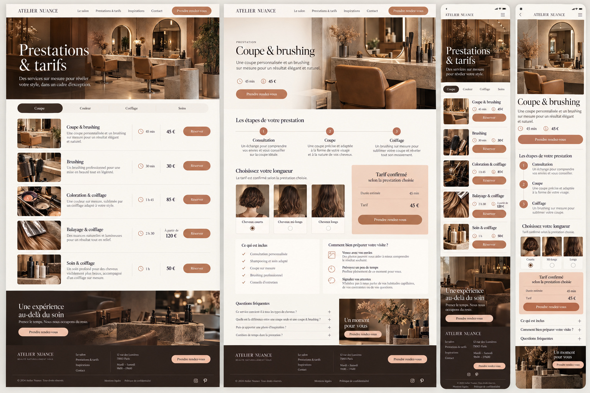
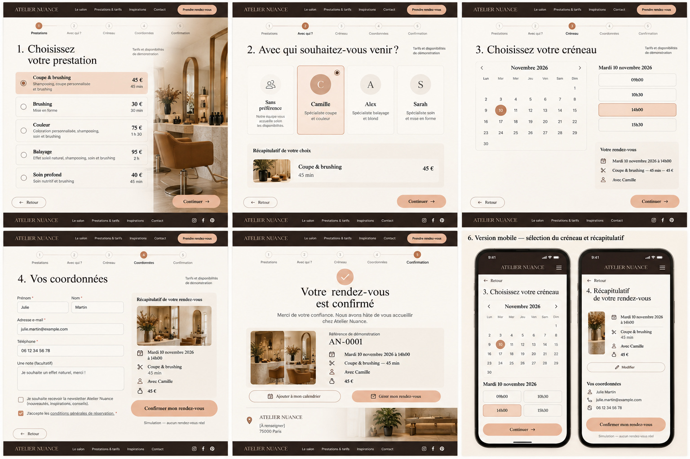
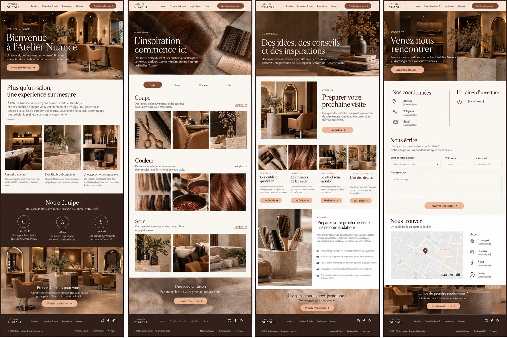
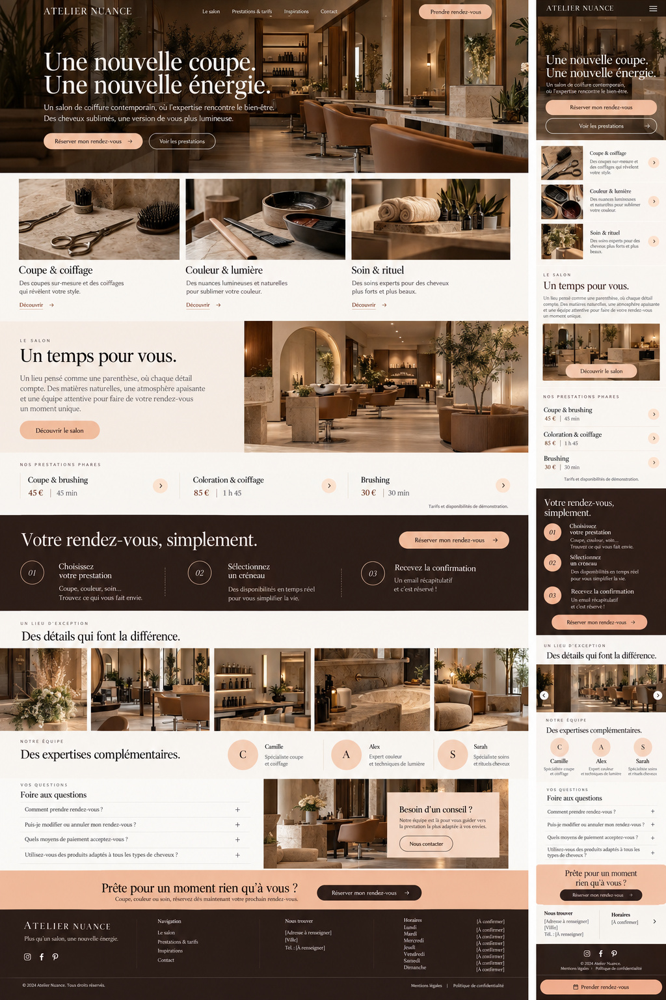
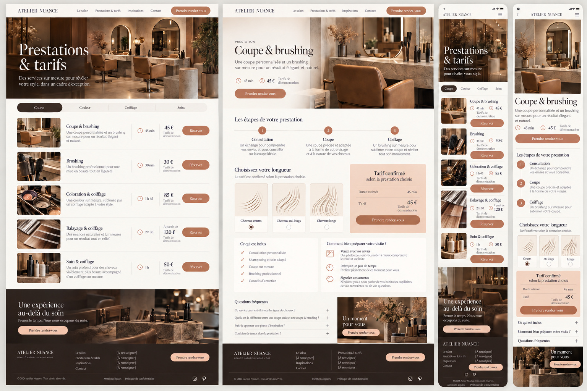
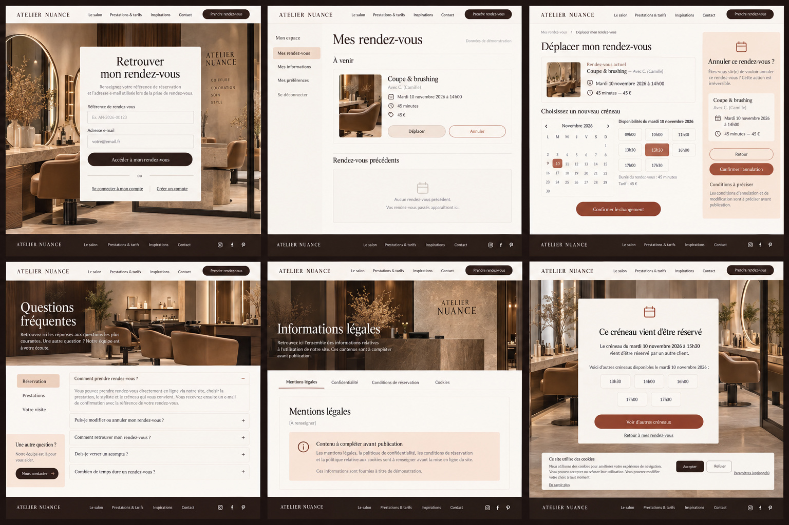

# ATELIER NUANCE

Mission pour la première conversation Claude après sa livraison actuelle.

Lire [CONSIGNE_CLAUDE.md](CONSIGNE_CLAUDE.md), [REUTILISATIONS.md](REUTILISATIONS.md) et [MEDIAS.csv](MEDIAS.csv). Les images HD sont fournies séparément par Thomas en ZIP de moins de 29 Mo ; décompresser toutes les parties dans le même dossier.

Six planches originales. La 05 corrigée prime sur la 01 pour les prestations. Les photos recréées peuvent présenter de légères différences de détail avec ces références.

## Planche 01

## Planche 02

## Planche 03

## Planche 04

## Planche 05

## Planche 06

Les six vues GitHub sont des JPEG qualité 95, sans réduction de dimensions. Les PNG originaux sont dans les ZIP. La numérotation est identique.
