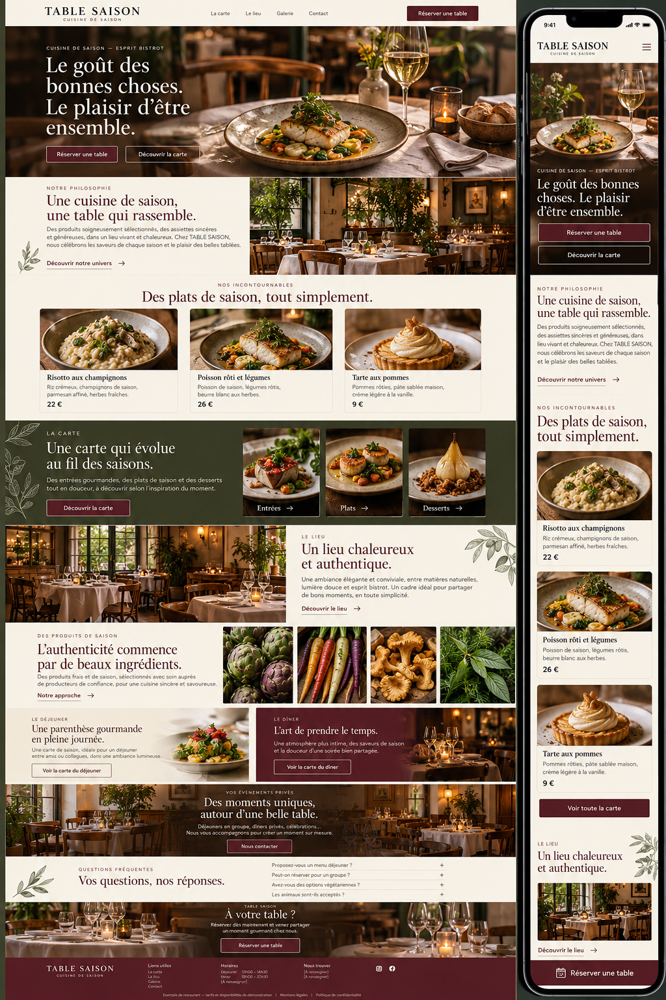
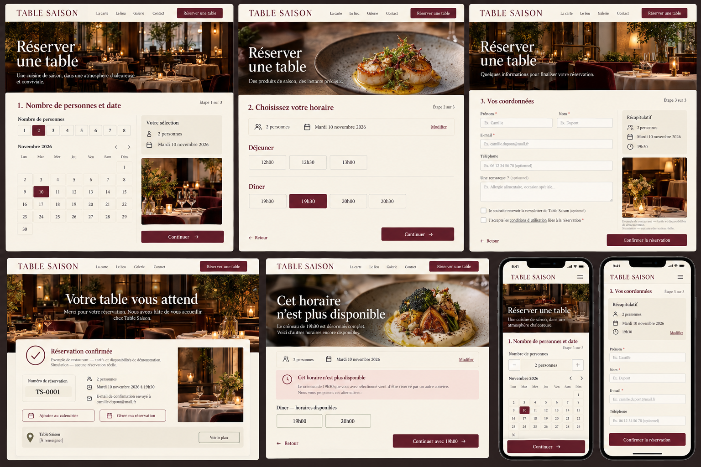
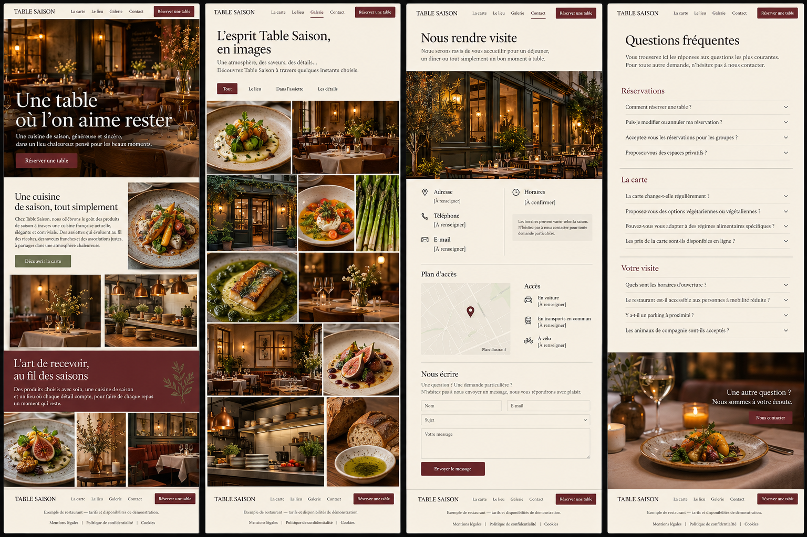
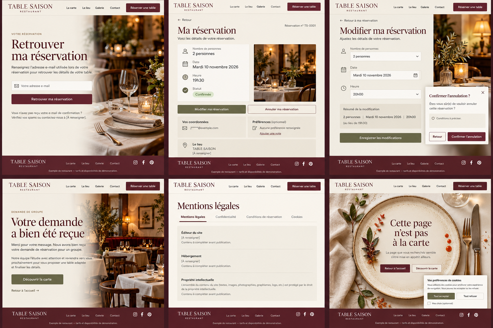

# TABLE SAISON — dossier de référence

Lire [la consigne complète](CONSIGNE_CLAUDE.md), puis [le repérage des 61 médias](MEDIAS.csv) et [les réutilisations](REUTILISATIONS.md).

Thomas fournit séparément les quatre ZIP d'images HD. Décompresser toutes les parties dans le même dossier. Les images ont été recréées par IA à partir des scènes des maquettes. Elles restent hors de ce dossier GitHub ; les cinq planches ci-dessous sont les originaux.

## 1. Accueil ordinateur et mobile

## 2. Carte, saisons et grandes tablées

## 3. Parcours de réservation

## 4. Lieu, galerie, contact et FAQ

## 5. Gestion de réservation, pages légales et 404

