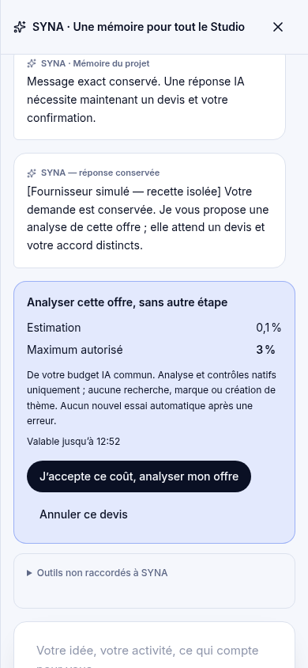
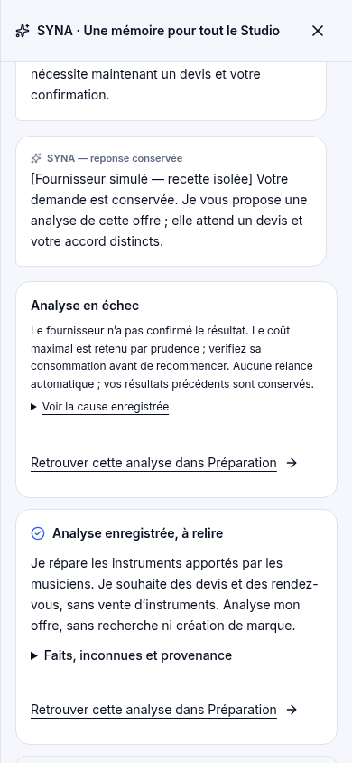
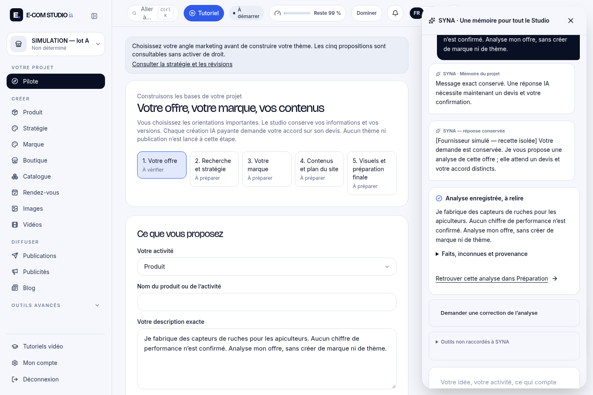

# D1 — SYNA lance une analyse native, pas seulement un conseil

PR #215 · Studio compilé propre `f490fd136433af4e9bc4533c4fb0795bed27e1c6`. Fournisseur HTTP **local simulé**, worker/SDK/versions/portefeuille natifs. Aucun appel réel, aucune donnée client. Ce sont des preuves fonctionnelles ; elles ne qualifient pas une IA ou une création professionnelle réelles.

Le résultat reste une proposition à relire. Ni recherche, ni marque, ni thème, ni approbation d’étape ne sont lancés.

## Captures originales, lisibles et téléchargeables

| Étape | Ordinateur : produit | Téléphone : service |
|---|---|---|
| Demande libre saisie (sauvegarde confirmée dans le JSON natif) | [PNG](captures/produit-demande-exacte.png) | [PNG](captures/service-demande-exacte.png) |
| Proposition de l’outil par la réponse IA simulée | [PNG](captures/produit-action-proposee.png) | [PNG](captures/service-action-proposee.png) |
| Devis de l’analyse et accord distinct | [PNG](captures/produit-devis-natif.png) | [PNG](captures/service-devis-natif.png) |
| Résultat acquis, à relire | [PNG](captures/produit-resultat-enregistre.png) | [PNG](captures/service-resultat-enregistre.png) |
| Retour au parcours Préparation natif | [PNG](captures/produit-preparation-native.png) | [PNG](captures/service-preparation-native.png) |
| Même reçu dans l’onglet Images | [PNG](captures/produit-meme-resultat-onglet-images.png) | [PNG](captures/service-meme-resultat-onglet-images.png) |
| Vérification à 360 px | [PNG](captures/produit-resultat-360.png) | [PNG](captures/service-resultat-360.png) |
| Reconnexion et reprise sans appel | [PNG](captures/produit-reprise-nouvelle-session.png) | [PNG](captures/service-reprise-nouvelle-session.png) |
| Correction en échec, première version conservée | [PNG](captures/produit-correction-en-echec-acquis-conserve.png) | [PNG](captures/service-correction-en-echec-acquis-conserve.png) |

Les captures de demande montrent la saisie réelle, parfois pendant sa sauvegarde. Les JSON ci-dessous contrôlent ensuite la description et son historique exacts. La présence d’un avertissement Images est normale : aucun fournisseur d’images n’est configuré dans ces fixtures ; aucun remplacement simplifié n’est fabriqué.

## Vidéos réelles du navigateur

- [Produit — MP4, 1 440 × 960, 14 s](videos/produit.mp4)
- [Service — MP4, 390 × 844, 13,28 s](videos/service.mp4)

Enregistrements automatisés, fournisseur simulé. Transcodage seulement : 350/350 et 332/332 images conservées, même durée, aucune coupe ni accélération. Les changements de largeur à 360 px sont visibles dans les captures et dans l’enregistrement à dimensions fixes.

## Preuves et limites

- [Recette HTTP et navigateur complète](api-proof.json)
- [État natif produit](tools-produit-native.json) · [service](tools-service-native.json)
- [Après panne simulée produit](tools-produit-failure.json) · [service](tools-service-failure.json)
- [Budget simulé : coûts enregistrés et réservations incertaines séparés](budget-simule.json)
- [Commandes, résultats et limites](verifications.json) · [sources testées](sources-testes.json)
- [Empreintes des médias](medias.json) · [contrôle des vidéos](videos-inspection.json)
- [Rapport D1](../211_LOT_D1_RESULTATS.md)

Aucune installation CMS, aucun téléphone physique/Safari, aucune génération fournisseur réelle. Les autres outils restent non raccordés : D restant, E et F2 continuent séparément. Aucun merge, activation ou déploiement.
