# SYNA — retouche native de thème et annulation (D2)

**22 captures originales et 2 vidéos réelles**, prises sur le Studio compilé propre `974d2b9e6956a0a5ecde150c27e921488d964ca4`. Fournisseur HTTP local simulé, données fictives isolées ; zéro API réelle/coût réel. Ces diagrammes de recette ne sont pas des créations professionnelles du lot E.

[Rapport](../211_LOT_D2_RESULTATS.md) · [Vérifications](verifications.json) · [Versions, budgets et absence de réservation des retouches](budget-simule.json) · [Inventaire SHA des médias](medias.json).

Demande libre → proposition IA simulée → devis avant/après → confirmation → vrai job/version → texte ou image effectivement rendu → reprise → annulation confirmée. Produit : cinq versions conservées ; service : trois.

## Produit

[Voir ou télécharger la vidéo MP4](https://raw.githubusercontent.com/spacedevelopment01-max/Ecom-studio-ia/codex/211-lot-d2-theme-actions/docs/coordination/preuves-211-D2/videos/produit.mp4)

### produit-annulation-360

[Ouvrir/télécharger en taille originale](https://raw.githubusercontent.com/spacedevelopment01-max/Ecom-studio-ia/codex/211-lot-d2-theme-actions/docs/coordination/preuves-211-D2/captures/produit-annulation-360.png)

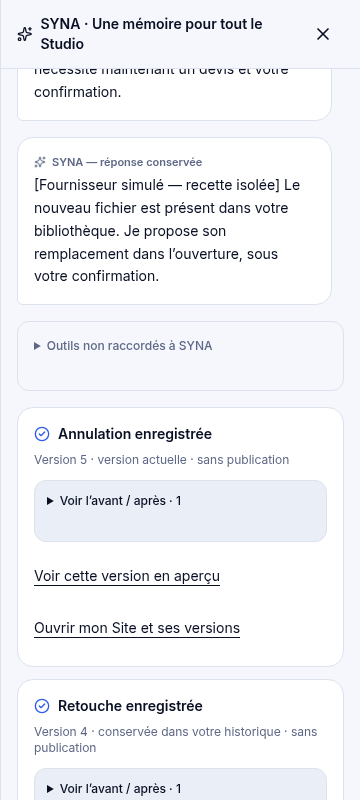

### produit-annulation-a-confirmer

[Ouvrir/télécharger en taille originale](https://raw.githubusercontent.com/spacedevelopment01-max/Ecom-studio-ia/codex/211-lot-d2-theme-actions/docs/coordination/preuves-211-D2/captures/produit-annulation-a-confirmer.png)

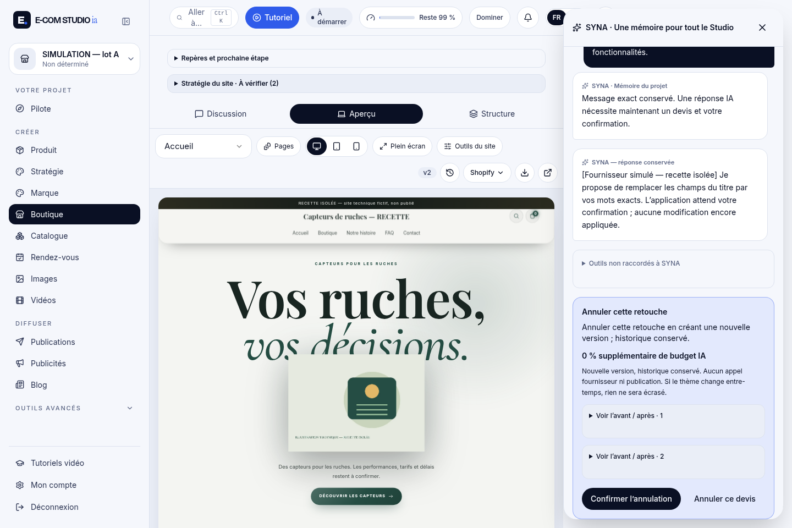

### produit-annulation-enregistree

[Ouvrir/télécharger en taille originale](https://raw.githubusercontent.com/spacedevelopment01-max/Ecom-studio-ia/codex/211-lot-d2-theme-actions/docs/coordination/preuves-211-D2/captures/produit-annulation-enregistree.png)

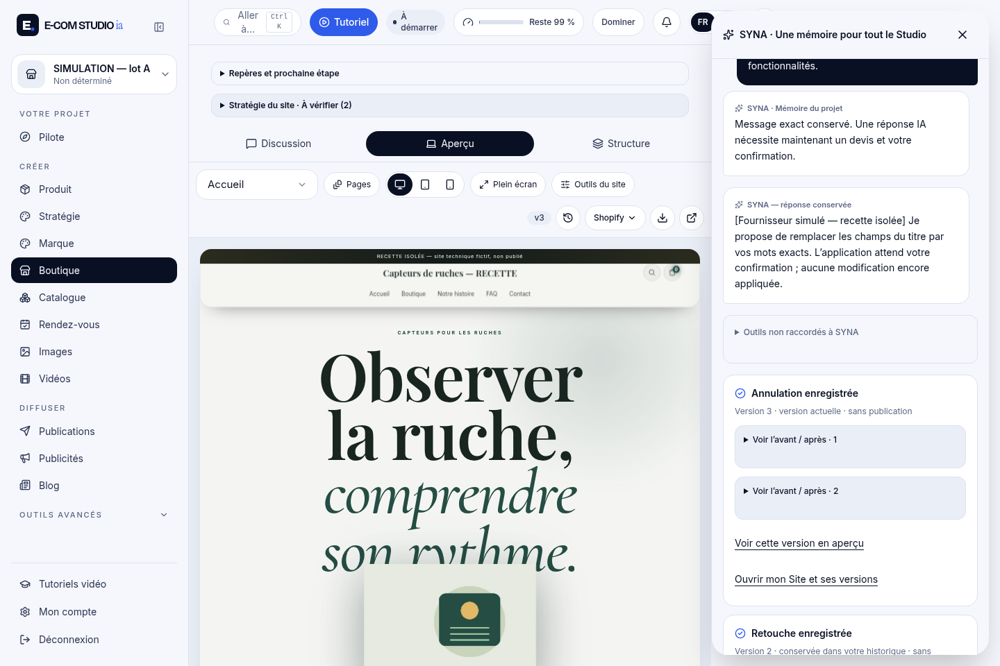

### produit-apres-retouche-visible

[Ouvrir/télécharger en taille originale](https://raw.githubusercontent.com/spacedevelopment01-max/Ecom-studio-ia/codex/211-lot-d2-theme-actions/docs/coordination/preuves-211-D2/captures/produit-apres-retouche-visible.png)

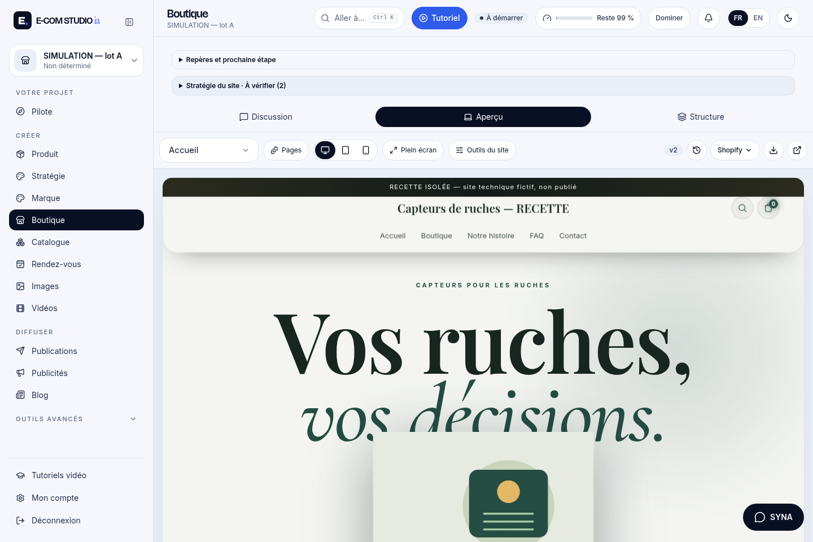

### produit-avant-retouche

[Ouvrir/télécharger en taille originale](https://raw.githubusercontent.com/spacedevelopment01-max/Ecom-studio-ia/codex/211-lot-d2-theme-actions/docs/coordination/preuves-211-D2/captures/produit-avant-retouche.png)

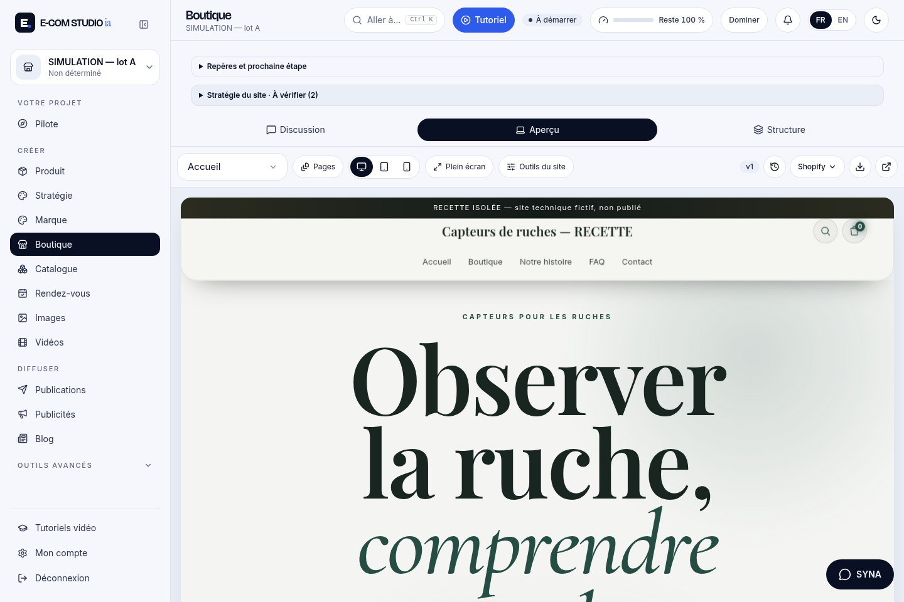

### produit-devis-local-avant-apres

[Ouvrir/télécharger en taille originale](https://raw.githubusercontent.com/spacedevelopment01-max/Ecom-studio-ia/codex/211-lot-d2-theme-actions/docs/coordination/preuves-211-D2/captures/produit-devis-local-avant-apres.png)

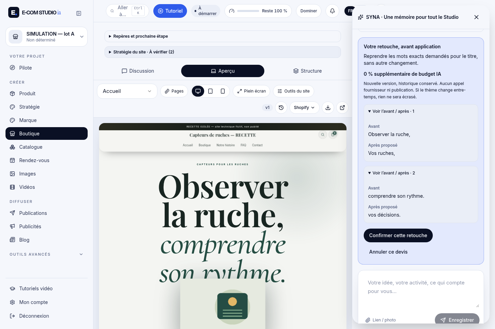

### produit-image-annulation-a-confirmer

[Ouvrir/télécharger en taille originale](https://raw.githubusercontent.com/spacedevelopment01-max/Ecom-studio-ia/codex/211-lot-d2-theme-actions/docs/coordination/preuves-211-D2/captures/produit-image-annulation-a-confirmer.png)

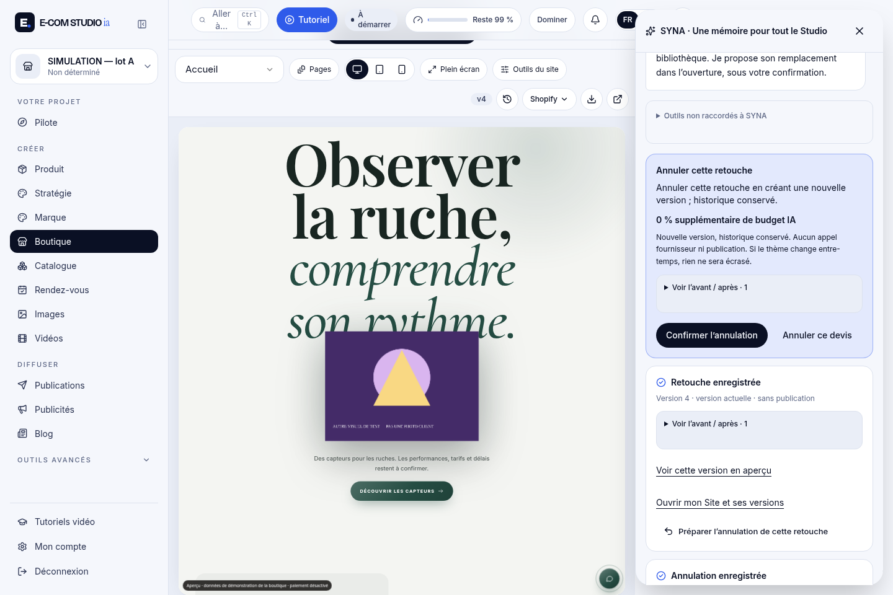

### produit-image-devis-vrais-visuels

[Ouvrir/télécharger en taille originale](https://raw.githubusercontent.com/spacedevelopment01-max/Ecom-studio-ia/codex/211-lot-d2-theme-actions/docs/coordination/preuves-211-D2/captures/produit-image-devis-vrais-visuels.png)

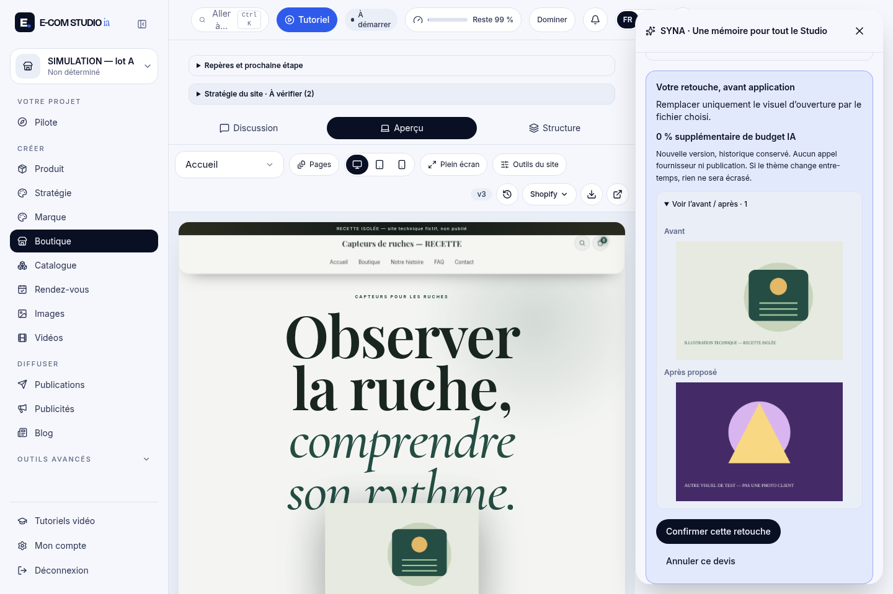

### produit-image-initiale-restauree

[Ouvrir/télécharger en taille originale](https://raw.githubusercontent.com/spacedevelopment01-max/Ecom-studio-ia/codex/211-lot-d2-theme-actions/docs/coordination/preuves-211-D2/captures/produit-image-initiale-restauree.png)

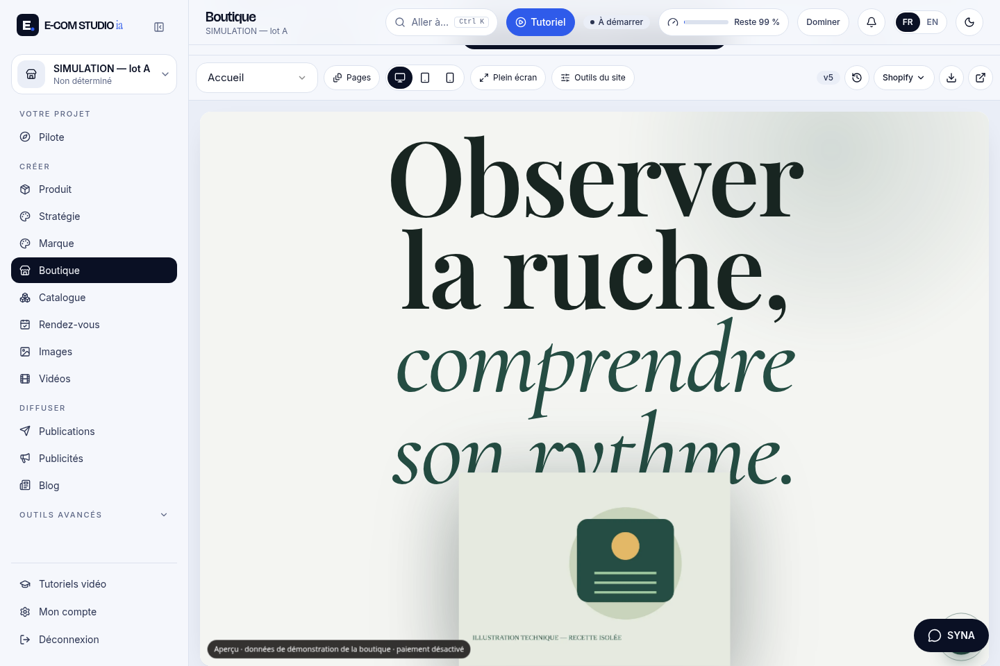

### produit-image-remplacee-visible

[Ouvrir/télécharger en taille originale](https://raw.githubusercontent.com/spacedevelopment01-max/Ecom-studio-ia/codex/211-lot-d2-theme-actions/docs/coordination/preuves-211-D2/captures/produit-image-remplacee-visible.png)

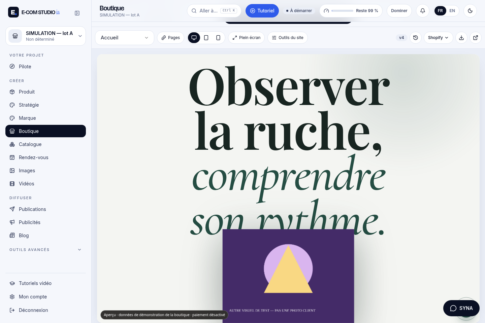

### produit-recu-version

[Ouvrir/télécharger en taille originale](https://raw.githubusercontent.com/spacedevelopment01-max/Ecom-studio-ia/codex/211-lot-d2-theme-actions/docs/coordination/preuves-211-D2/captures/produit-recu-version.png)

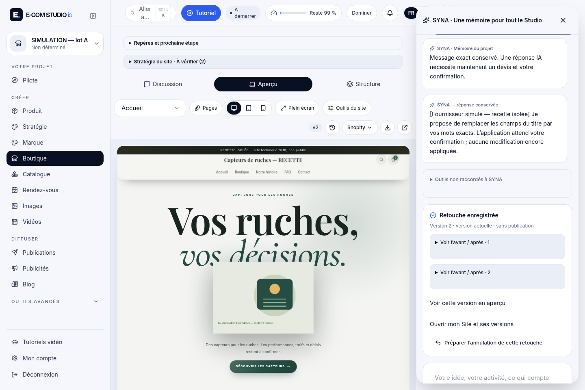

### produit-reprise-sans-nouvel-appel

[Ouvrir/télécharger en taille originale](https://raw.githubusercontent.com/spacedevelopment01-max/Ecom-studio-ia/codex/211-lot-d2-theme-actions/docs/coordination/preuves-211-D2/captures/produit-reprise-sans-nouvel-appel.png)

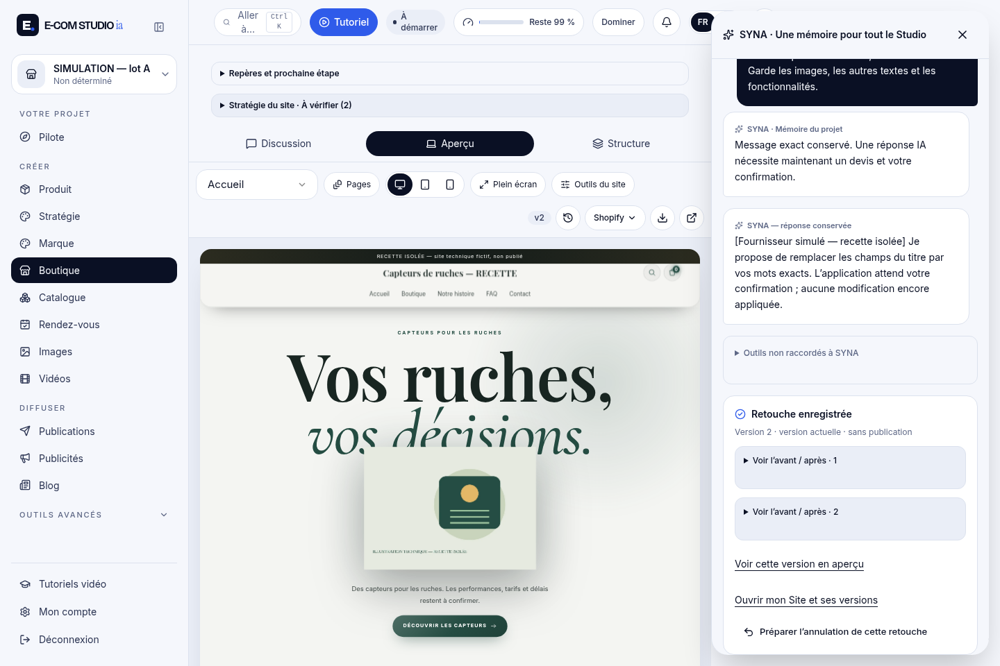

### produit-version-initiale-restauree

[Ouvrir/télécharger en taille originale](https://raw.githubusercontent.com/spacedevelopment01-max/Ecom-studio-ia/codex/211-lot-d2-theme-actions/docs/coordination/preuves-211-D2/captures/produit-version-initiale-restauree.png)

## Service

[Voir ou télécharger la vidéo MP4](https://raw.githubusercontent.com/spacedevelopment01-max/Ecom-studio-ia/codex/211-lot-d2-theme-actions/docs/coordination/preuves-211-D2/videos/service.mp4)

### service-annulation-360

[Ouvrir/télécharger en taille originale](https://raw.githubusercontent.com/spacedevelopment01-max/Ecom-studio-ia/codex/211-lot-d2-theme-actions/docs/coordination/preuves-211-D2/captures/service-annulation-360.png)

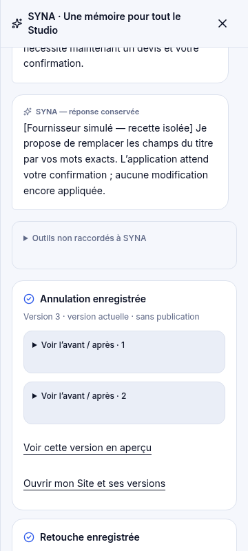

### service-annulation-a-confirmer

[Ouvrir/télécharger en taille originale](https://raw.githubusercontent.com/spacedevelopment01-max/Ecom-studio-ia/codex/211-lot-d2-theme-actions/docs/coordination/preuves-211-D2/captures/service-annulation-a-confirmer.png)

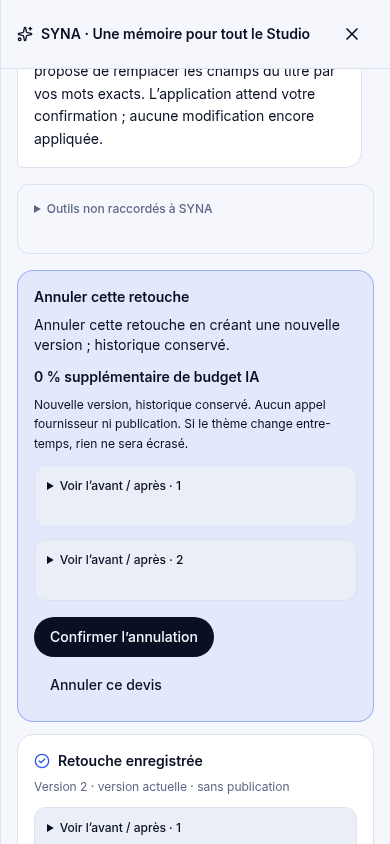

### service-annulation-enregistree

[Ouvrir/télécharger en taille originale](https://raw.githubusercontent.com/spacedevelopment01-max/Ecom-studio-ia/codex/211-lot-d2-theme-actions/docs/coordination/preuves-211-D2/captures/service-annulation-enregistree.png)

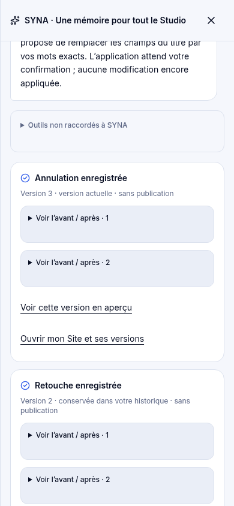

### service-apres-retouche-visible

[Ouvrir/télécharger en taille originale](https://raw.githubusercontent.com/spacedevelopment01-max/Ecom-studio-ia/codex/211-lot-d2-theme-actions/docs/coordination/preuves-211-D2/captures/service-apres-retouche-visible.png)

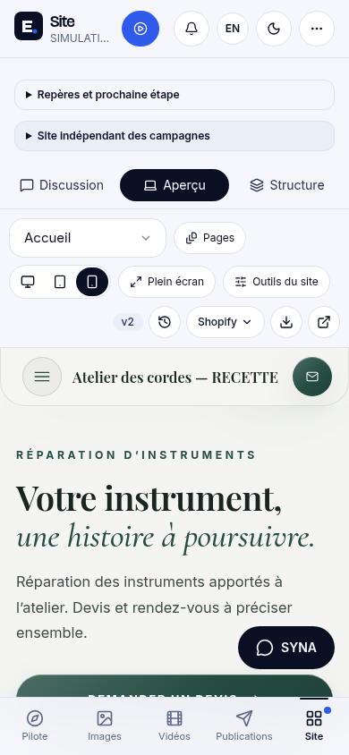

### service-avant-retouche

[Ouvrir/télécharger en taille originale](https://raw.githubusercontent.com/spacedevelopment01-max/Ecom-studio-ia/codex/211-lot-d2-theme-actions/docs/coordination/preuves-211-D2/captures/service-avant-retouche.png)

### service-devis-local-avant-apres

[Ouvrir/télécharger en taille originale](https://raw.githubusercontent.com/spacedevelopment01-max/Ecom-studio-ia/codex/211-lot-d2-theme-actions/docs/coordination/preuves-211-D2/captures/service-devis-local-avant-apres.png)

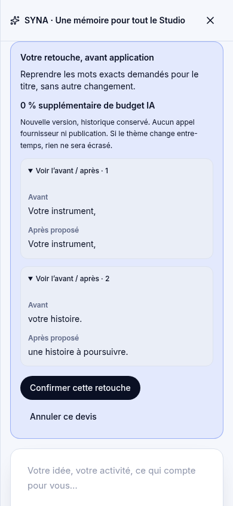

### service-recu-version

[Ouvrir/télécharger en taille originale](https://raw.githubusercontent.com/spacedevelopment01-max/Ecom-studio-ia/codex/211-lot-d2-theme-actions/docs/coordination/preuves-211-D2/captures/service-recu-version.png)

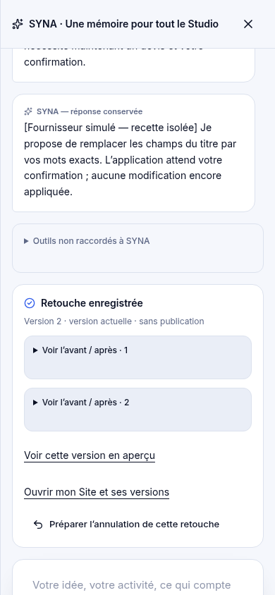

### service-reprise-sans-nouvel-appel

[Ouvrir/télécharger en taille originale](https://raw.githubusercontent.com/spacedevelopment01-max/Ecom-studio-ia/codex/211-lot-d2-theme-actions/docs/coordination/preuves-211-D2/captures/service-reprise-sans-nouvel-appel.png)

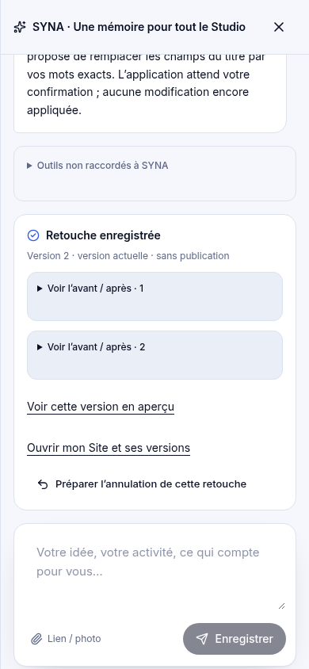

### service-version-initiale-restauree

[Ouvrir/télécharger en taille originale](https://raw.githubusercontent.com/spacedevelopment01-max/Ecom-studio-ia/codex/211-lot-d2-theme-actions/docs/coordination/preuves-211-D2/captures/service-version-initiale-restauree.png)

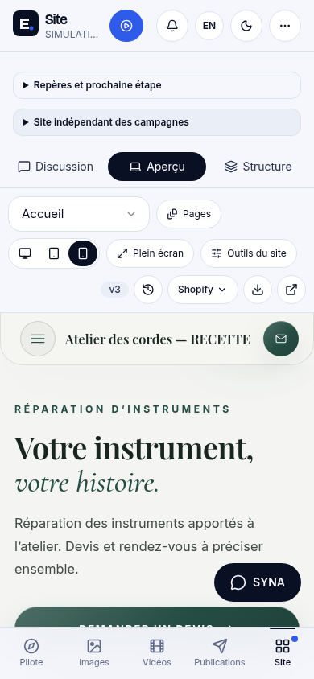

## Limites

Chromium automatisé : pas un téléphone physique, Safari, une installation CMS, une vraie génération ou une preuve de compréhension créative du modèle. Texte complet/H1, média décodé et octets correspondants, autres champs préservés et restauration intégrale contrôlés. Vidéos sans coupe ni accélération ; captures stabilisées après les transitions. Main, projets clients et démonstrations inchangés.
