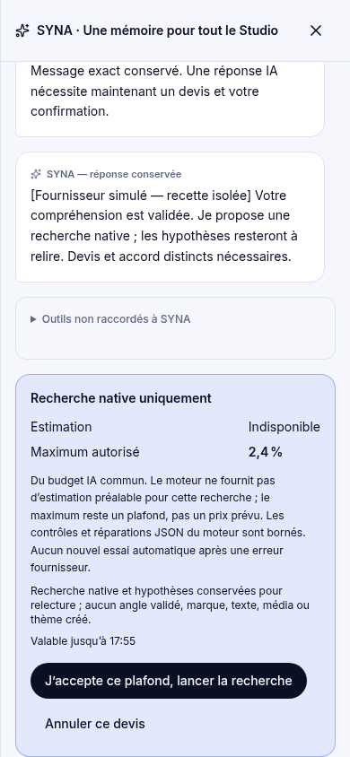
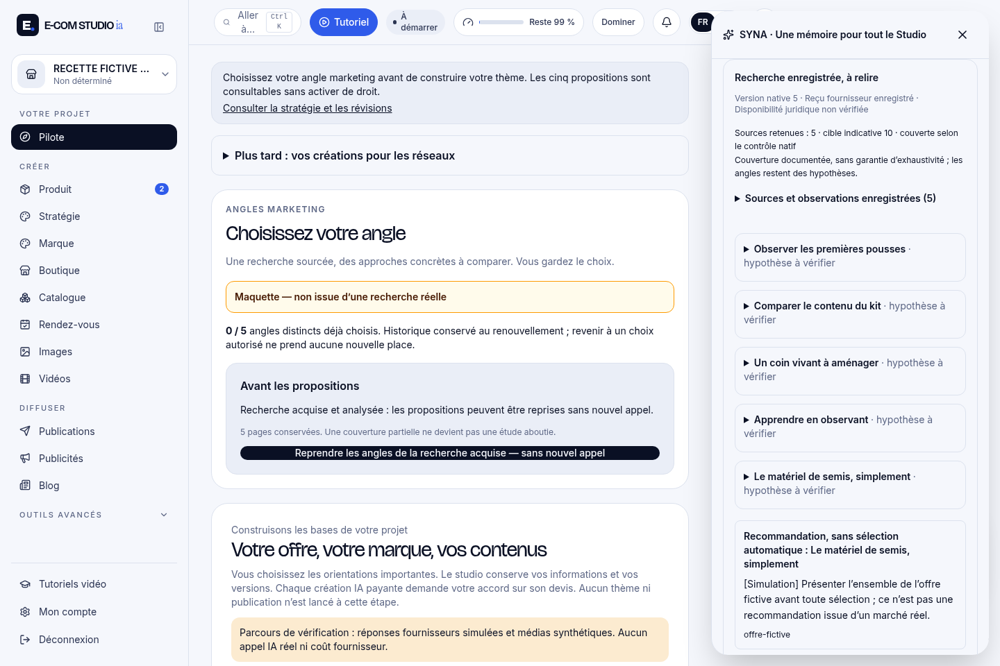
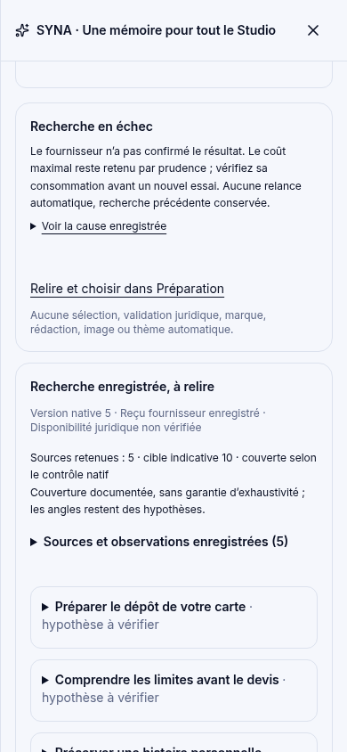
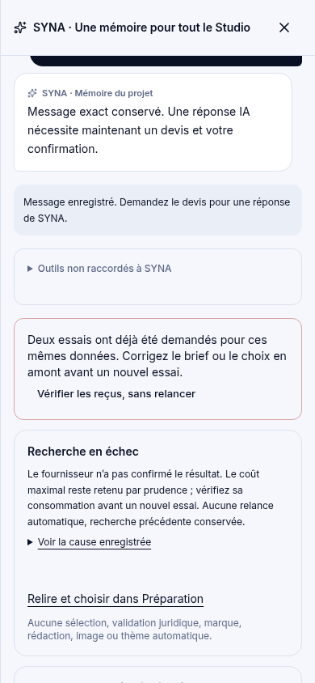

# #211 D4 — galerie et téléchargements

Recette isolée sur **c6cbc69b4be33ea8c216c0887f2cd09a5a95c5ff**, build de production propre. Vrai navigateur/worker/SDK, fournisseur local et pages sources **fictifs**, aucune consultation Internet réelle, aucune qualité stratégique ou créative qualifiée. Aucun merge ni activation.

[Rapport et limites](../211_LOT_D4_RESULTATS.md) · [Preuve JSON](api-proof.json) · [Budget/reprise](budget-et-reprise.json)

## Vidéos réelles, sans coupe ni accélération

- [Produit — lire/télécharger le MP4](videos/produit.mp4?raw=1)
- [Service — lire/télécharger le MP4](videos/service.mp4?raw=1)

## 34 captures originales

Chaque lien ouvre le PNG original. Produit : 1440 px puis contrôles 390/360 ; service : 390 px puis 360. Aucun agrandissement artificiel des captures.

| Étape | Produit fictif : kit de semis | Service fictif : restauration de cartes |
|---|---|---|
| Demande exacte | [PNG](captures/produit-demande-exacte.png?raw=1) | [PNG](captures/service-demande-exacte.png?raw=1) |
| Proposition de SYNA | [PNG](captures/produit-action-proposee.png?raw=1) | [PNG](captures/service-action-proposee.png?raw=1) |
| Devis natif | [PNG](captures/produit-devis-plafond-natif.png?raw=1) | [PNG](captures/service-devis-plafond-natif.png?raw=1) |
| Résultat conservé | [PNG](captures/produit-resultat-natif.png?raw=1) | [PNG](captures/service-resultat-natif.png?raw=1) |
| Carte manuelle actualisée | [PNG](captures/produit-etat-manuel-actualise.png?raw=1) | [PNG](captures/service-etat-manuel-actualise.png?raw=1) |
| Sources fictives déclarées | [PNG](captures/produit-sources-fictives-explicites.png?raw=1) | [PNG](captures/service-sources-fictives-explicites.png?raw=1) |
| Hypothèse 1 intégrale | [PNG](captures/produit-hypothese-1-integrale.png?raw=1) | [PNG](captures/service-hypothese-1-integrale.png?raw=1) |
| Hypothèse 2 intégrale | [PNG](captures/produit-hypothese-2-integrale.png?raw=1) | [PNG](captures/service-hypothese-2-integrale.png?raw=1) |
| Hypothèse 3 intégrale | [PNG](captures/produit-hypothese-3-integrale.png?raw=1) | [PNG](captures/service-hypothese-3-integrale.png?raw=1) |
| Hypothèse 4 intégrale | [PNG](captures/produit-hypothese-4-integrale.png?raw=1) | [PNG](captures/service-hypothese-4-integrale.png?raw=1) |
| Hypothèse 5 intégrale | [PNG](captures/produit-hypothese-5-integrale.png?raw=1) | [PNG](captures/service-hypothese-5-integrale.png?raw=1) |
| Résultat 390 px | [PNG](captures/produit-resultat-390.png?raw=1) | [PNG](captures/service-resultat-390.png?raw=1) |
| Résultat 360 px | [PNG](captures/produit-resultat-360.png?raw=1) | [PNG](captures/service-resultat-360.png?raw=1) |
| Reprise après connexion/onglet | [PNG](captures/produit-reprise-autre-onglet.png?raw=1) | [PNG](captures/service-reprise-autre-onglet.png?raw=1) |
| Échec, acquis conservé | [PNG](captures/produit-echec-acquis-conserve.png?raw=1) | [PNG](captures/service-echec-acquis-conserve.png?raw=1) |
| Conversation reprise après échec | [PNG](captures/produit-conversation-reprise-apres-echec.png?raw=1) | [PNG](captures/service-conversation-reprise-apres-echec.png?raw=1) |
| Limite avant nouveau devis | [PNG](captures/produit-limite-native-sans-nouvel-accord.png?raw=1) | [PNG](captures/service-limite-native-sans-nouvel-accord.png?raw=1) |

## Aperçus

Devis avec plafond et estimation indisponible :

Recherche visible dans SYNA et carte manuelle réellement actualisée :

Échec et première recherche conservée :

Troisième demande refusée avant devis, aucun nouvel appel :

Les JSON natifs et leurs réservations permettent de distinguer livraison, échec et coûts incertains. Neuf générations simulées, sept usages connus (55 384 micro fictifs), deux réservations incertaines (maximum 329 095 micro fictifs) conservées séparément. **0 fournisseur réel / coût réel nul.** Les champs de modèles dans les JSON sont référencés par empreinte. Les captures montrent aussi les limites de présentation héritées des onglets manuels ; rien n’a été effacé pour améliorer artificiellement les preuves.
