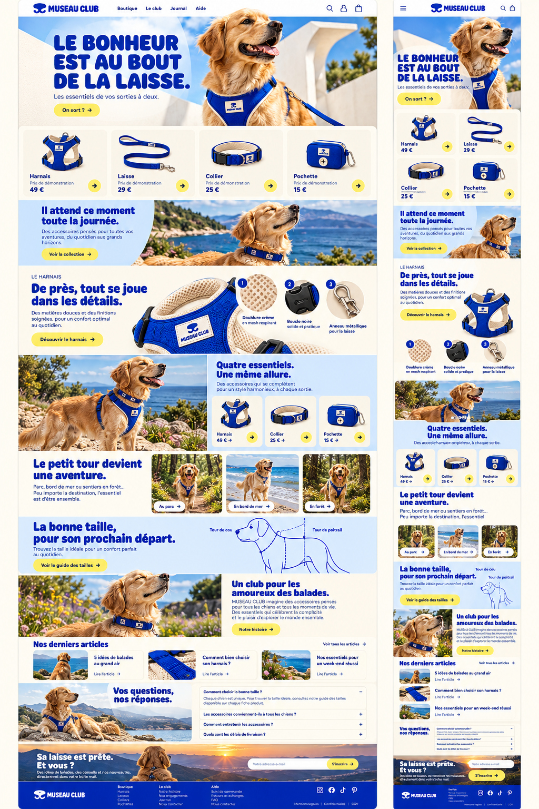
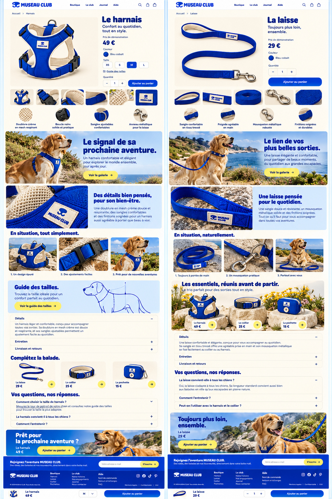
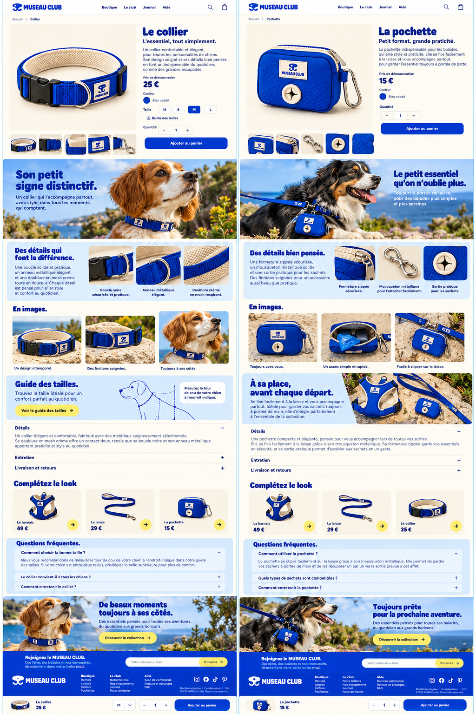
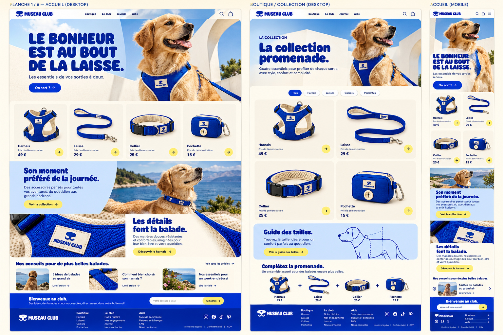
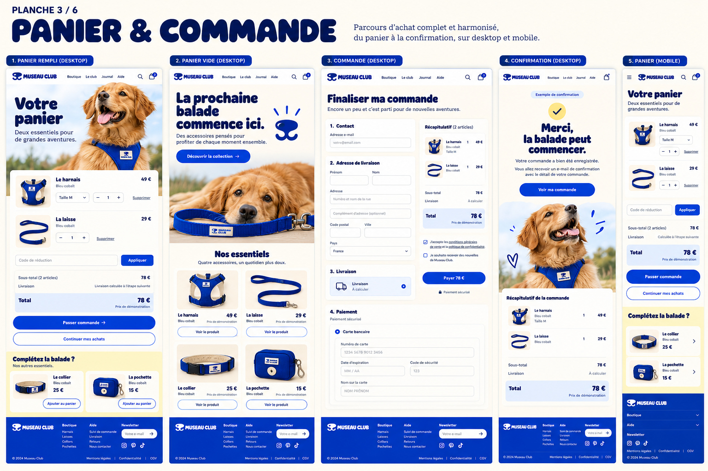
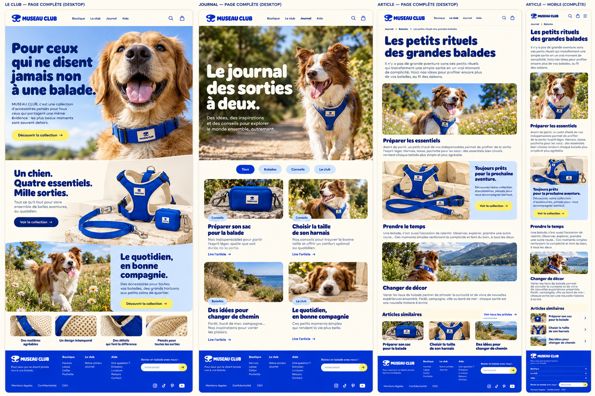
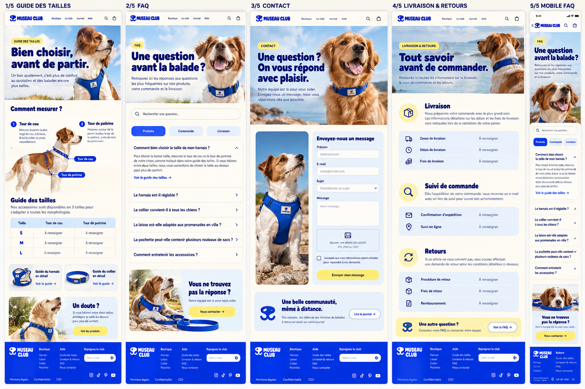
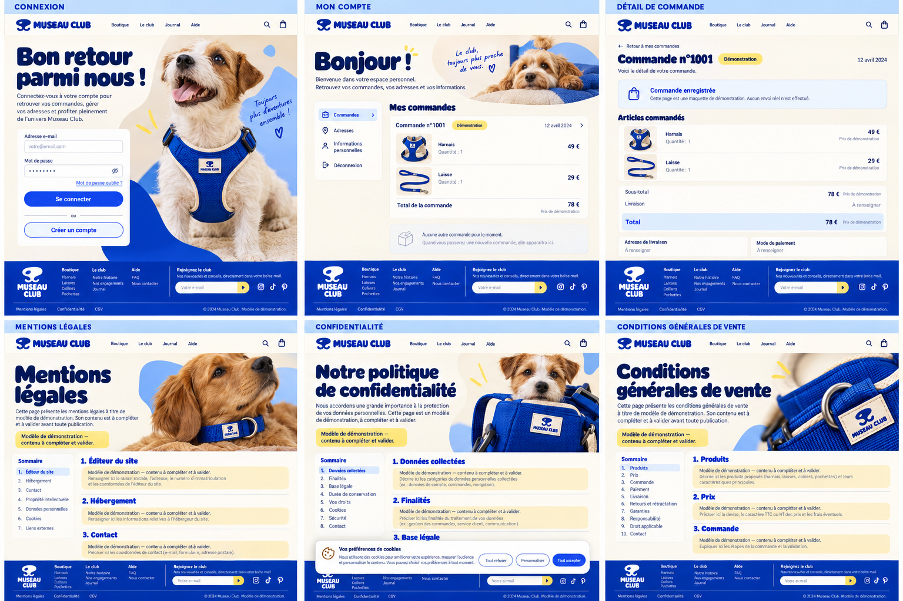

# MUSEAU CLUB — dossier de réalisation, 23 octobre 2026

Lire [CONSIGNE_VALIDEE.md](CONSIGNE_VALIDEE.md) intégralement avant de travailler.

**8 planches visuelles + 31 médias originaux.** Les 3 premières planches sont les versions enrichies demandées par Thomas et font autorité sur l’accueil et les quatre fiches produit. La planche 04 ne vaut que pour la colonne Boutique centrale. Les autres pages restent fondées sur les planches 05 à 08.

Les photos originales viennent du kit existant : 1 logo, 20 vues produit, 10 ambiances. Certaines nouvelles scènes de chiens existent uniquement dans les planches : ne pas confondre la présence du kit avec la livraison de toutes ces scènes en haute définition séparée. La consigne explique comment relever et traiter ces écarts.

## Lire réellement les images

Les maquettes sont des JPG standard testés par décodage complet, sans réduction des dimensions. Les WebP du kit ont aussi été décodés intégralement. Le manifeste donne dimensions et SHA-256. Les noms des fichiers ne prouvent pas leur lecture : ouvrir les pixels dans l’outil visuel local.

Depuis le dépôt :

```sh
git fetch origin claude/themes-differenciation
lecture_dir=$(mktemp -d)
git archive origin/claude/themes-differenciation docs/design/museau-club-reference-20261023 | tar -x -C "$lecture_dir"
printf '%s\n' "$lecture_dir/docs/design/museau-club-reference-20261023"
```

Cette extraction n’écrase aucun travail local. Ouvrir ensuite chaque chemin absolu `maquettes/*.jpg` avec l’outil visuel Read (si disponible), puis les médias. Un WebFetch de page GitHub ne remplace pas la lecture de l’image. En cas d’échec, relever fichier et erreur précise ; ne pas demander à Thomas de renvoyer des fichiers déjà disponibles.

## Galerie des références

### 01-accueil-enrichi.jpg



### 02-harnais-laisse-enrichis.jpg



### 03-collier-pochette-enrichis.jpg



### 04-boutique-reference.jpg



### 05-panier-commande.jpg



### 06-club-journal-article.jpg



### 07-tailles-aide-contact.jpg



### 08-compte-pages-legales.jpg


