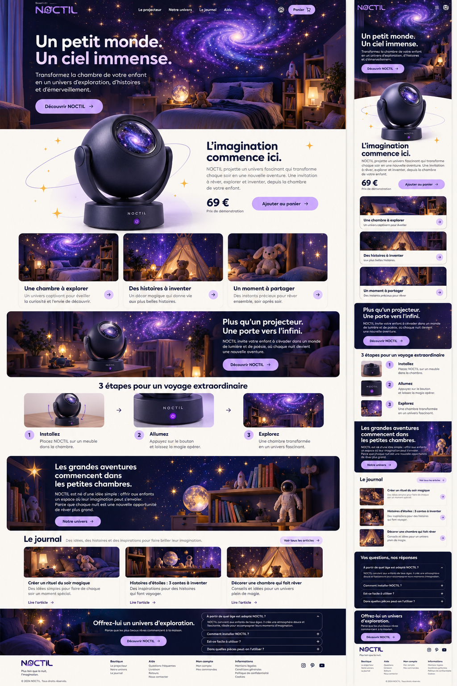
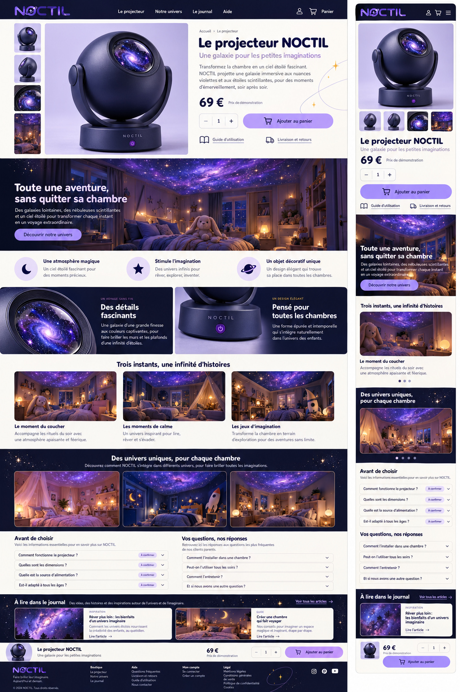
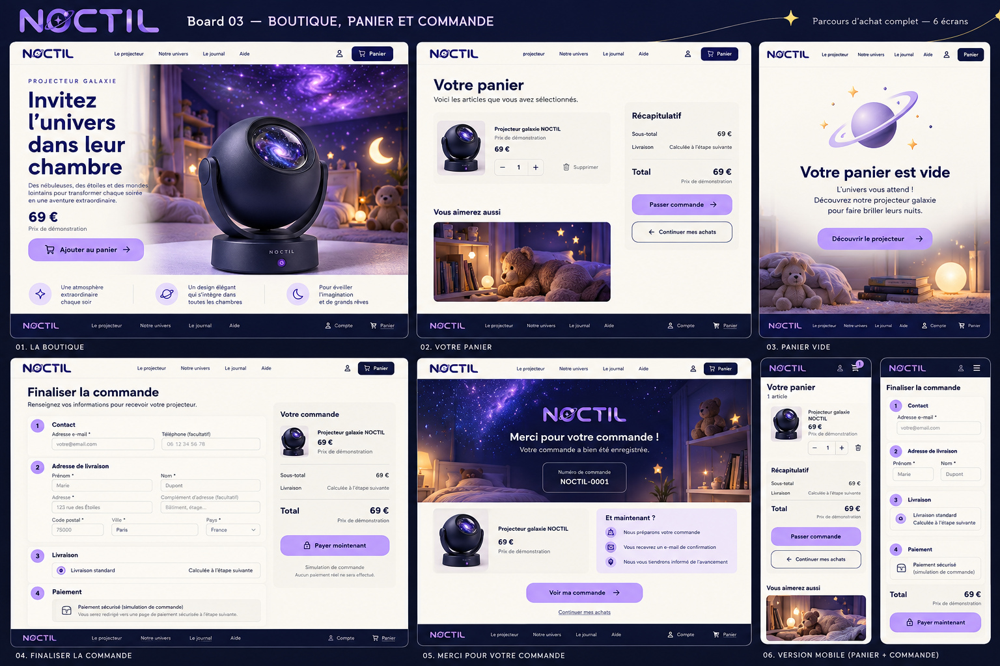
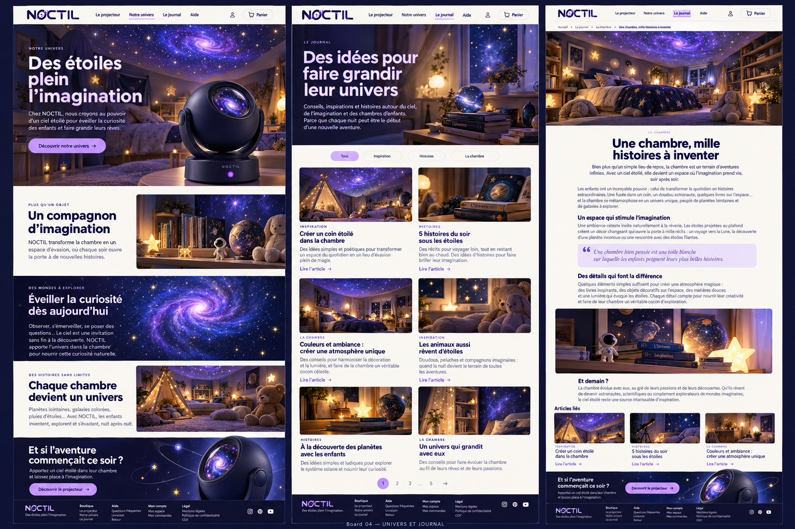
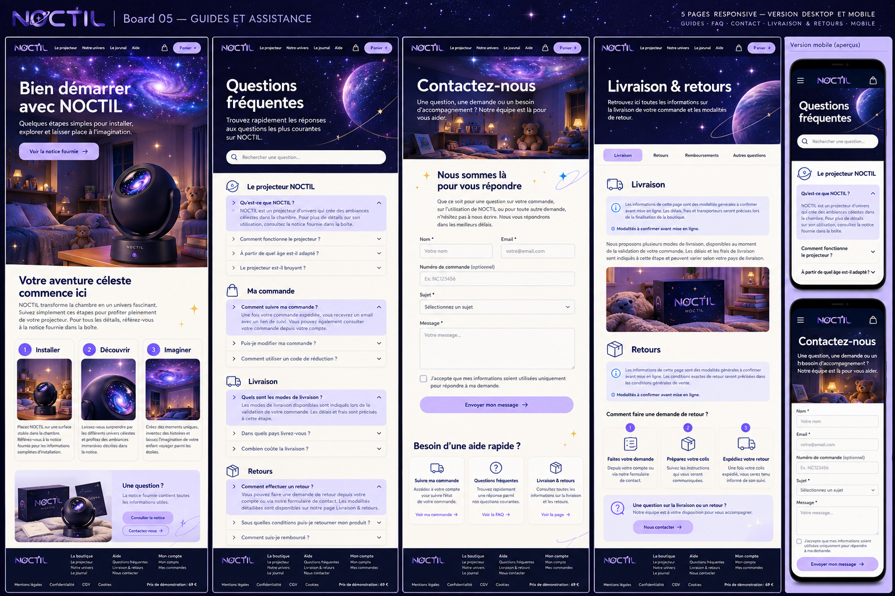
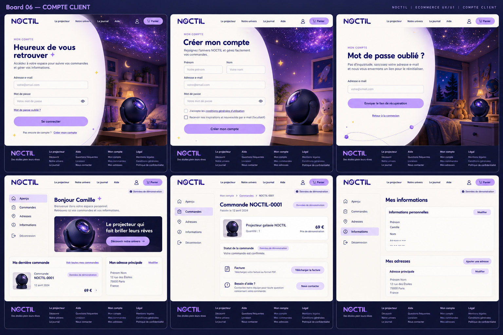
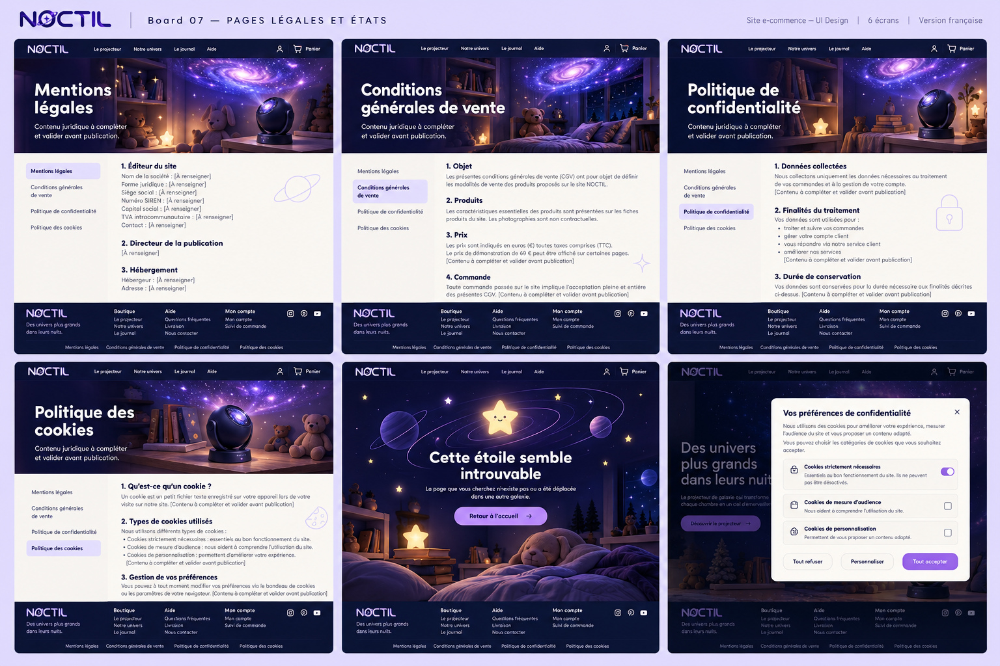

# NOCTIL — références complètes du 23 octobre 2026

Lire [CONSIGNE_VALIDEE.md](CONSIGNE_VALIDEE.md), puis [MEDIAS.md](MEDIAS.md).

**Point bloquant : le projecteur détouré doit remonter dans le hero, au-dessus de la jonction avec la section crème, sur ordinateur ET mobile.**

## Maquettes : ouvrir chaque JPG localement

### 01-accueil

### 02-produit

### 03-commerce

### 04-univers-journal

### 05-aide

### 06-compte

### 07-legal-etats

## Lecture locale

Récupérer uniquement ce dossier depuis la branche de livraison, sans remplacer les modifications applicatives. Ouvrir les fichiers avec un outil de lecture visuelle local, pas seulement WebFetch. Tous les fichiers image ont été intégralement décodés.

## Médias

26 fichiers séparés : 16 historiques et 10 complémentaires. Les nouvelles photos sont des reconstructions depuis les références ; voir les écarts explicites dans MEDIAS.md.