# TRAVERSE — ouvrir les images dans Claude

Les 4 maquettes et 9 photographies sont de vrais fichiers Git. Lire d’abord CONSIGNE_VALIDEE.md.

## Accès local recommandé

Depuis le dépôt, récupérer la branche :

```sh
git fetch origin claude/themes-differenciation
```

Pour consulter les images sans écraser le travail local, extraire le dossier dans un répertoire temporaire :

```sh
lecture_dir=$(mktemp -d)
git archive origin/claude/themes-differenciation docs/design/traverse-reference-20261023 | tar -x -C "$lecture_dir"
printf '%s\n' "$lecture_dir/docs/design/traverse-reference-20261023/lecture-jpg"
```

Ouvrir ensuite chaque JPG avec l’outil de lecture VISUELLE de fichiers de Claude (Read avec un chemin local absolu, si disponible). Un fetch textuel d’une page GitHub, un inventaire ou une chaîne base64 ne permet pas de voir une image. Ne pas demander à Thomas de renvoyer les fichiers avant d’avoir essayé l’extraction Git et la lecture visuelle locale. En cas d’échec, donner le chemin et l’erreur exacte.

Les JPG conservent dimensions et cadrage ; ce sont des copies de compatibilité avec compression, sans nouvelle génération. Les WebP restent les sources pour intégrer le thème. Ne pas utiliser les planches comme pages-image.

## Réparation vérifiée le 23 octobre 2026

L’ancien medias/detail-poche.webp était tronqué : 786445 octets présents contre 868608 annoncés dans son en-tête RIFF. Son décodage échouait. Remplacement depuis le PNG original « Poche zippée olive, étiquette TRAVERSE.png », encodé sans perte. L’empreinte du manifeste principal est actualisée. Aucun changement de composition du site.

Contrôle : décodage complet des 13 WebP et 13 JPEG ; dimensions et SHA-256 consignés dans manifest-lecture.json. Ce contrôle ne constitue pas une confirmation de lecture dans la session distante de Claude.

## Galerie des fichiers

### 01-accueil-composition

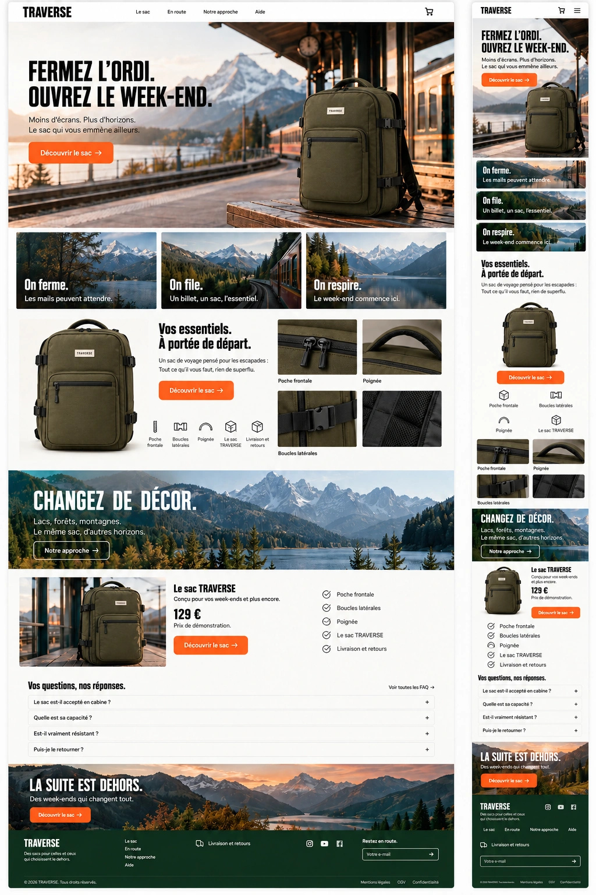

### 02-commerce-composition

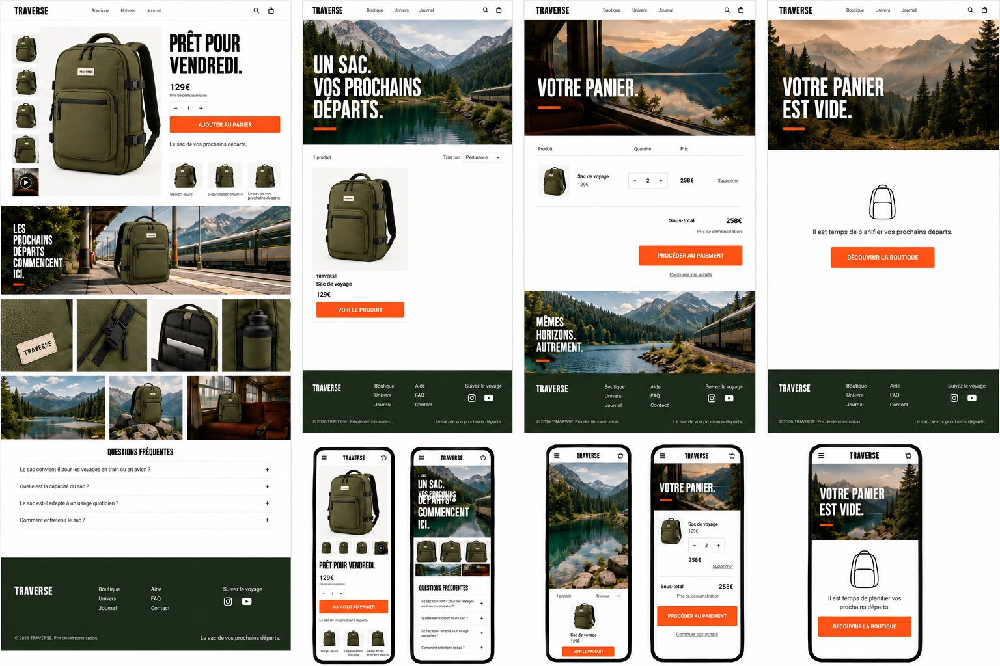

### 03-pages-complementaires

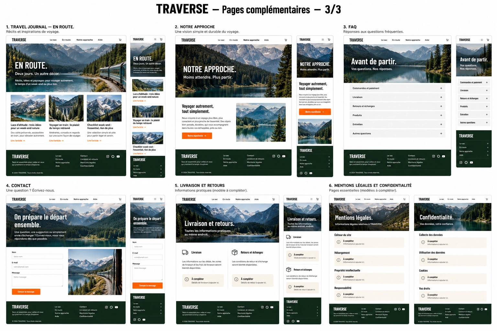

### 04-article-et-legal

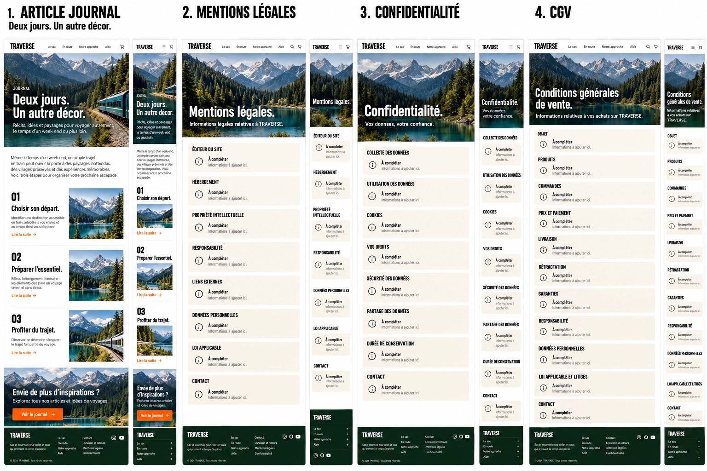

### detail-boucle

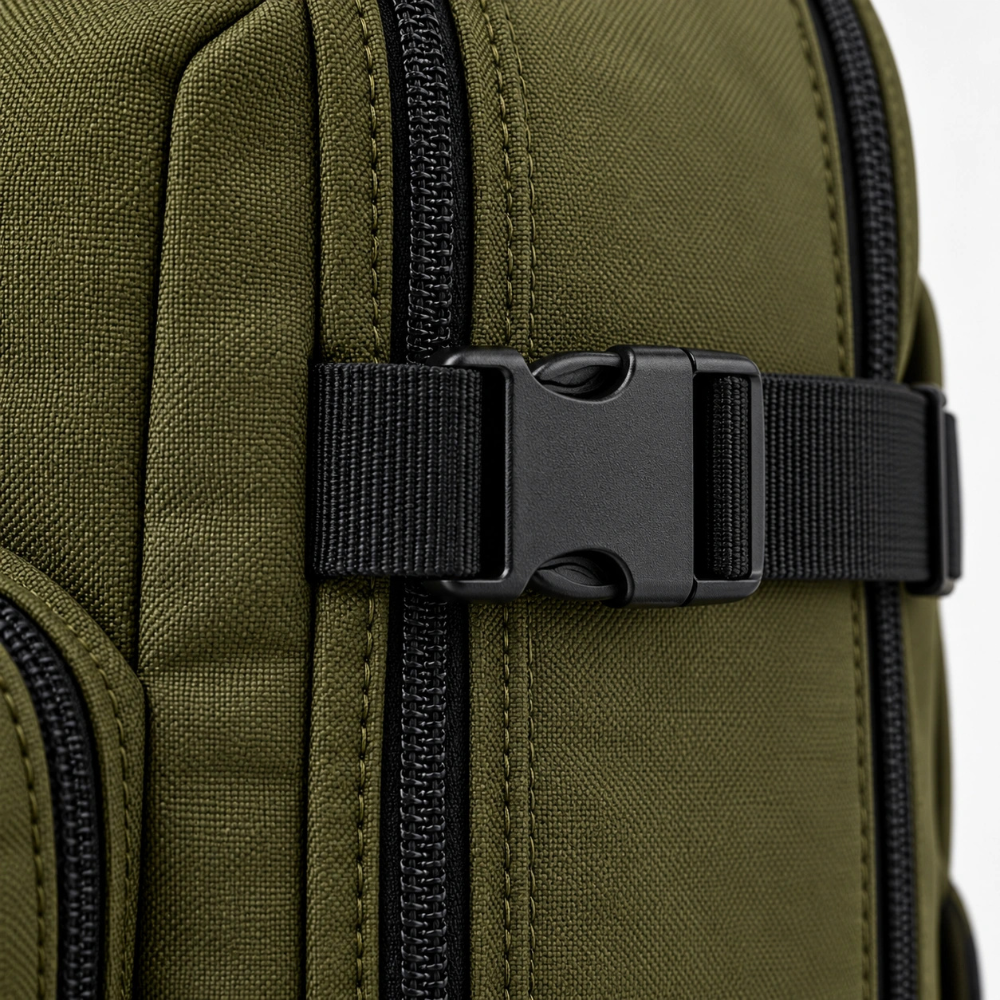

### detail-poche

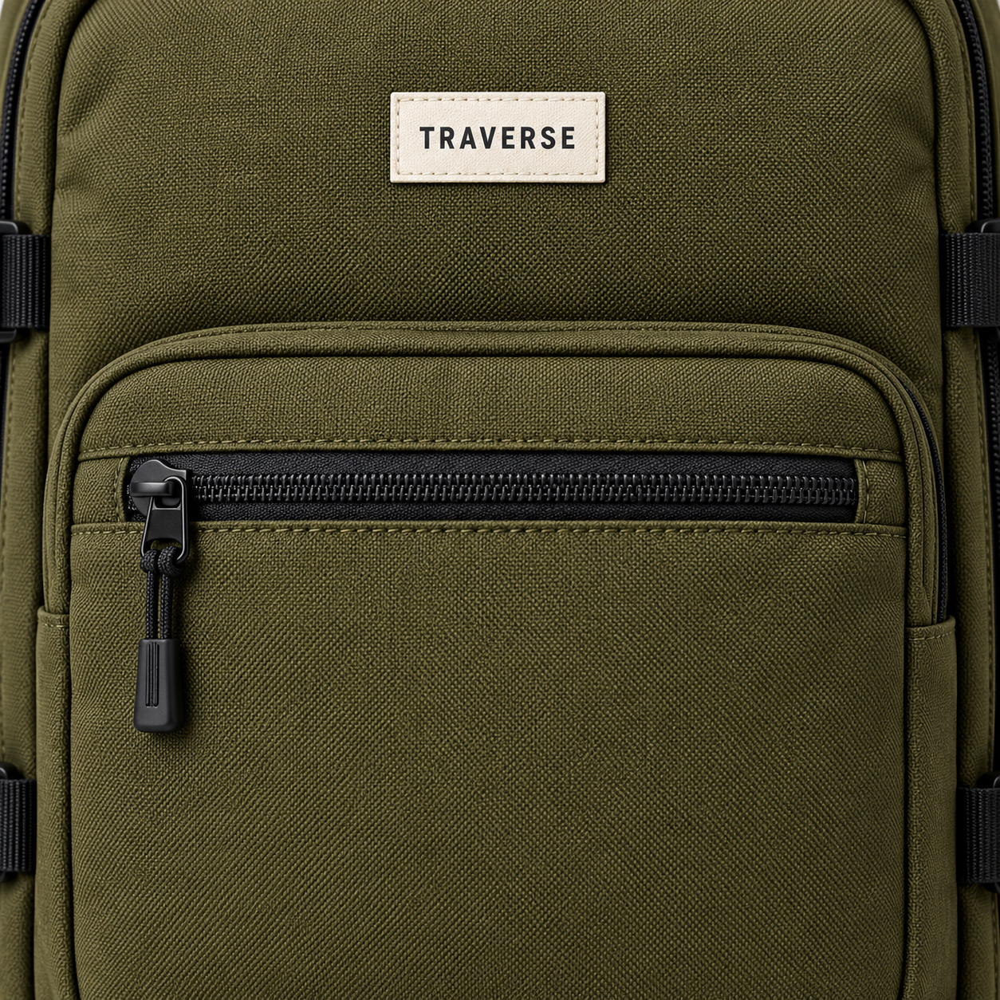

### detail-poignee

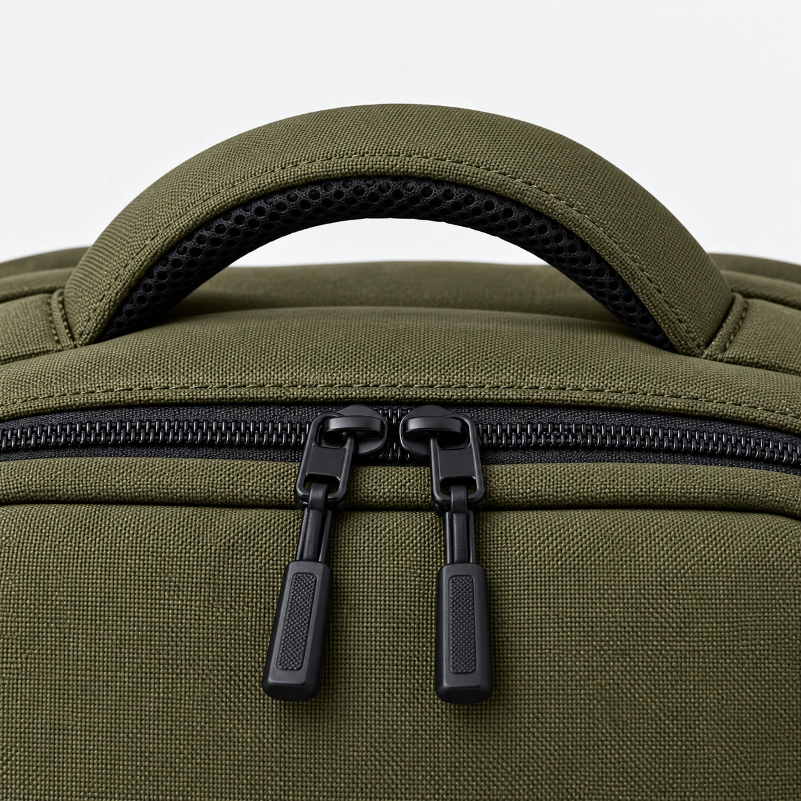

### hero-gare

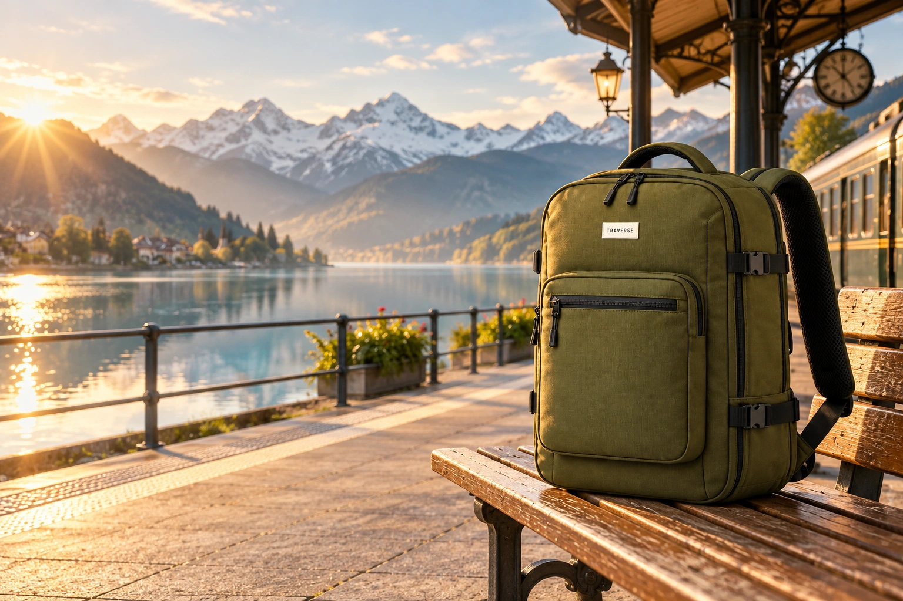

### lac

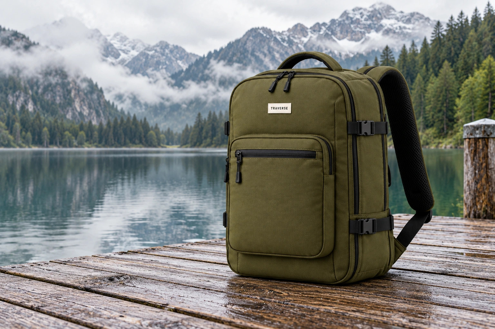

### montagne

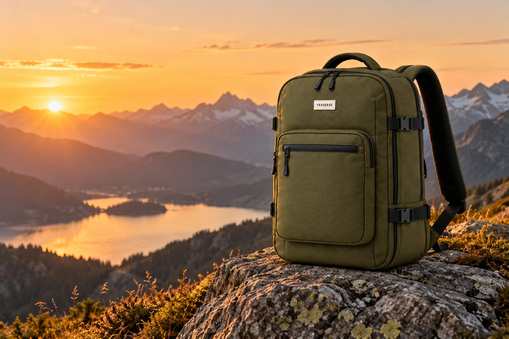

### paysage


### produit-reference

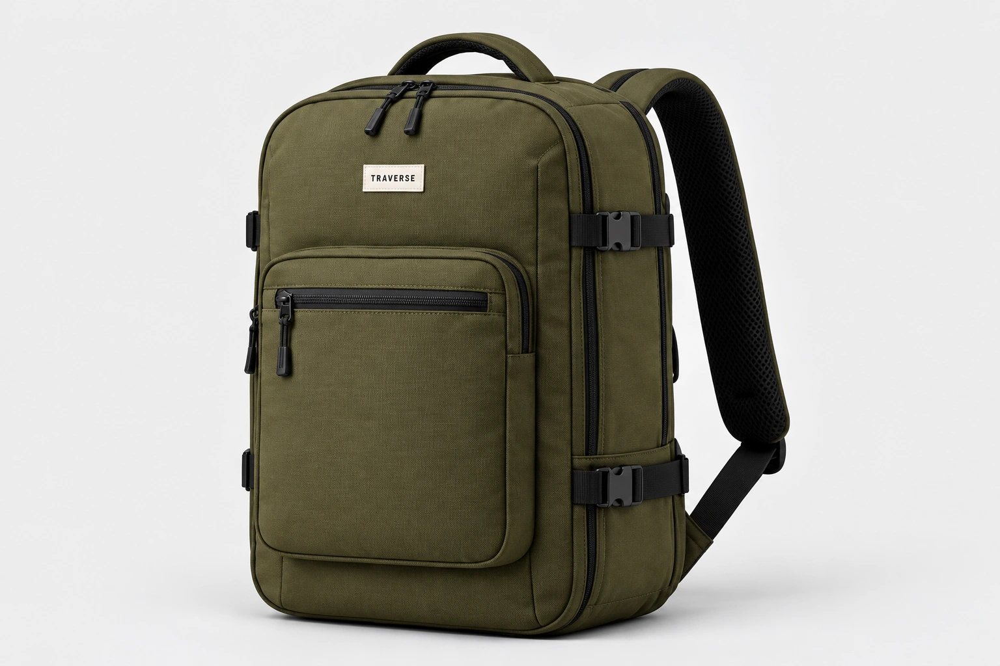

### train

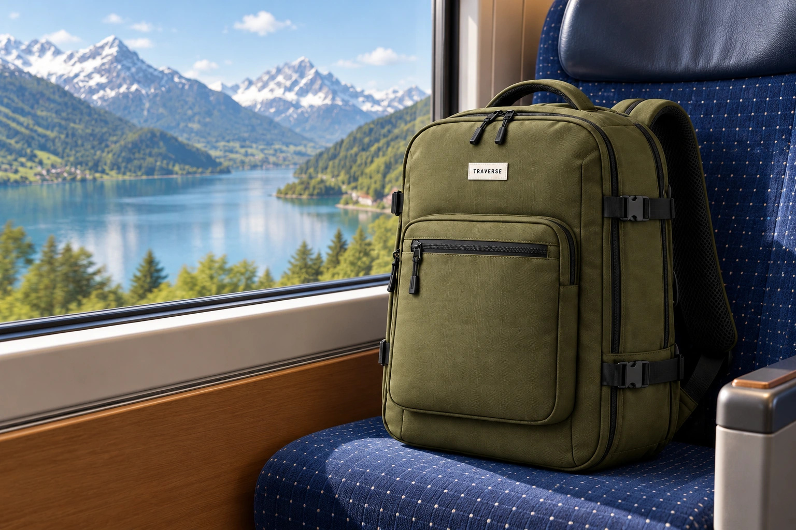
