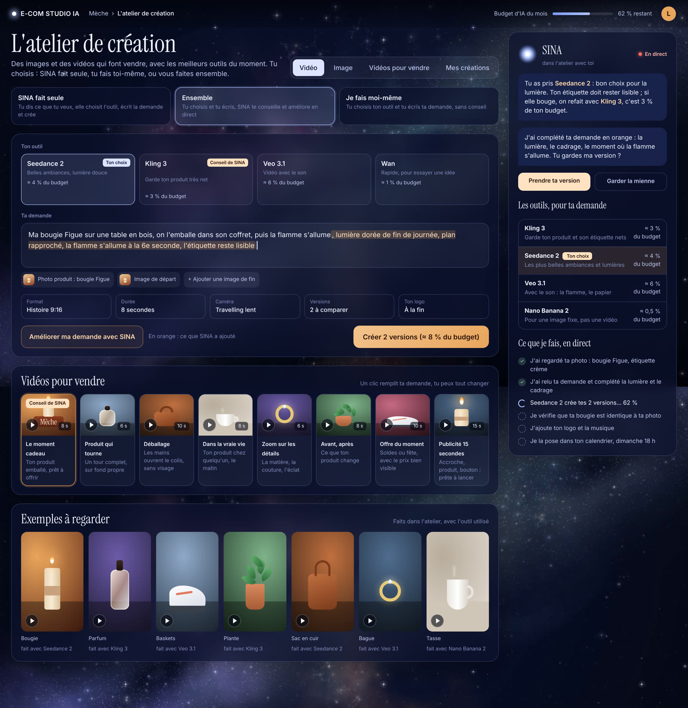

# L'atelier de création

Ce que le propriétaire veut : une plateforme de création d'images et de vidéos par IA, comme Higgsfield, mais à notre
nom, dans le Studio, plus simple, avec SINA qui s'en sert et conseille en direct. Écrit le 22 novembre 2026 à partir de
ses mots des 18 et 21 novembre 2026. Rien n'est encore construit.

*Maquette du 18 novembre 2026, sur un projet inventé. Les produits y sont dessinés, ce ne sont pas de vraies créations ;
les points forts des outils et les pourcentages sont des exemples, à vérifier par de vrais essais.*

## 1. Ses mots

- « Est-ce que je peux faire une sorte de plateforme Higgsfield mais à notre nom dans le studio ? »
- « Il faut comme le site Higgsfield mais en plus simple d'utilisation et surtout SINA qui s'en servirait en direct et
  donnerait des conseils sur ce qu'il faut faire et quel fournisseur choisir. Il faut comme dans Higgsfield des vidéos
  d'exemple, et Higgsfield a une partie vidéo IA pour le e-commerce : il faudrait faire comme ça aussi. »
- « Le client doit pouvoir choisir entre mes fournisseurs et mettre des prompts. »
- « Il doit y avoir les deux possibilités : SINA fait seule et le client fait seul, ou les deux s'associent. »

## 2. En une phrase

Un atelier où le client crée des images et des vidéos qui font vendre, avec les meilleurs outils du moment, au choix
seul, avec SINA, ou en laissant SINA tout faire, et où chaque création part en un clic vers ses publications, ses
publicités ou son site.

## 3. Trois façons de faire, au choix du client

| Façon | Ce que fait le client | Ce que fait SINA |
|---|---|---|
| **SINA fait seule** | Il dit ce qu'il veut, avec ses mots. | Elle choisit l'outil, écrit la demande, crée, vérifie et montre. |
| **Ensemble** | Il choisit son outil et écrit sa demande. | Elle commente le choix de l'outil, améliore la demande, prévient d'un risque, vérifie avant de montrer. |
| **Je fais moi-même** | Il choisit son outil et écrit sa demande. | Rien, sauf les contrôles obligatoires (personnes réelles, produit, budget). |

Le client change de façon quand il veut.

## 4. Ce que le client voit

**Les onglets** : Vidéo, Image, Vidéos pour vendre, Mes créations.

**La création** :
- **Son outil** : il choisit parmi les fournisseurs du propriétaire (partie 6). Chaque outil dit en une ligne ce qu'il
  fait de mieux et ce qu'il coûte en part du budget d'IA du mois. SINA marque celui qu'elle conseille.
- **Sa demande** : il l'écrit lui-même (le « prompt »). Il ajoute sa photo produit (gardée identique), une image de
  départ ou une image de fin.
- **Les réglages** : format (histoire 9:16, publication 1:1, publicité 4:5, site 16:9), durée, mouvement de caméra,
  nombre de versions à comparer, son logo à la fin.
- **Le prix avant** : toujours en part de son budget d'IA du mois (« ≈ 4 % de ton budget »), jamais en euros.

**Les vidéos pour vendre** (la partie e-commerce, comme chez Higgsfield, en plus simple) : des modèles prêts, chacun avec
sa vidéo d'exemple et sa durée. Un clic remplit la demande, le client peut tout changer. Exemples de la maquette :
- le moment cadeau (le produit emballé, prêt à offrir) ;
- le produit qui tourne ;
- le déballage (des mains, jamais de visage) ;
- le produit dans la vraie vie ;
- le zoom sur les détails ;
- l'avant et l'après ;
- l'offre du moment (soldes ou fête, prix bien visible) ;
- la publicité de 15 secondes, prête à lancer.

**Les exemples à regarder** : des vidéos et des images faites dans l'atelier, sur des produits très différents, avec le
nom de l'outil utilisé sous chacune.

**Mes créations** : tout reste rangé par projet. En un clic, une création part vers une publication (dans le
calendrier), une publicité (prête à lancer) ou le site.

## 5. SINA en direct

- **Elle conseille quoi faire** : le bon modèle de vidéo pour le moment (« pour la fête des mères, le moment cadeau »).
- **Elle conseille quel outil, et dit pourquoi** : par exemple celui qui garde le mieux l'étiquette nette, ou celui qui
  fait la plus belle lumière. Elle prend par défaut le moins cher qui suffit et garde les plus chers pour ce qui en a
  vraiment besoin, en le disant avant.
- **Elle améliore la demande** : « Améliorer ma demande avec SINA » ; ses ajouts sont montrés à part (en orange sur la
  maquette), et le client prend sa version ou garde la sienne.
- **Elle montre ce qu'elle fait** : demande relue, création en cours, vérification, logo, date dans le calendrier.
- **Elle vérifie avant de montrer** : le produit est identique à la photo du client, aucune personne n'apparaît sans son
  accord, le logo est là, le texte se lit sur un téléphone.
- **Elle propose la suite** : « une version carrée pour ta publication de dimanche ? ».

## 6. Les outils (fournisseurs du propriétaire)

D'après la partie 16 de la référence (accord du propriétaire du 18 novembre 2026) :
- **Vidéo** : Kling, Seedance (autorisé par ByteDance le 21 novembre 2026, à ses conditions écrites), Wan (Alibaba,
  données gardées en Europe), Google (Veo 3.1 Fast et Lite par Vertex, Gemini Omni Flash).
- **Image** : OpenAI (obligatoire pour les images des publications de SINA), Nano Banana de Google, Flux, Qwen.
- **Secours** : Runware, seul intermédiaire, à la place de Higgsfield.
- **Écartés** : Runway, Luma, Ideogram, Midjourney, Adobe Firefly, Kie (raisons dans la partie 16).

Peu d'outils, les meilleurs, chacun essayé pour de vrai avant d'être proposé. Les modèles changent souvent : la liste se
tient à jour.

## 7. Les règles qui s'appliquent

- Aucun appel à l'IA sans abonnement ; le client ne voit jamais d'euros pour l'IA.
- Jamais de personne dans une image ou une vidéo sans photo fournie par le client ou accord écrit ; aucune fausse
  image d'une vraie personne.
- Le vrai produit du client reste identique ; SINA n'invente jamais les biens à vendre.
- Les conditions de chaque fournisseur sont respectées (pour Seedance : celles de l'autorisation de ByteDance) ; la
  mention « fait par l'IA » est mise quand la loi ou le fournisseur l'exigent.
- Pas de branchement aux plateformes de réseaux pour l'instant : la création part dans le Studio, le client publie d'un
  geste.
- Les vidéos se traitent en dernier.

## 8. Le prix (recherche du 18 novembre 2026)

- Higgsfield achète les modèles des autres et les revend en crédits, comme nous avec le budget d'IA du mois. Sa taille
  lui donne des prix de gros : sur Veo, ses clients paient moins que notre prix d'achat. On ne se bat pas sur le prix de
  la vidéo seule ; ce que vend le Studio, c'est tout le reste et SINA.
- En direct, Kling et Seedance coûtent nettement moins cher que chez les intermédiaires (jusqu'à deux fois moins pour
  Seedance face à fal) ; face à Higgsfield, l'écart est petit (environ 10 à 15 %).
- La vidéo coûte cher pour le budget d'un forfait : il faudra des limites claires ou des recharges, à décider au lot des
  forfaits.

## 9. Les conditions conseillées par Claude (18 novembre 2026, non encore validées par le propriétaire)

1. Peu d'outils, les meilleurs, essayés pour de vrai avant d'être proposés.
2. Le budget d'IA réglé avant d'ouvrir (limites par forfait ou recharges).
3. Des garde-fous sur les demandes libres (personnes réelles, contenus interdits) avant toute ouverture.
4. Ne pas passer avant le reste : la partie images avec les publications (lot 5), la vidéo au lot 9.

## 10. Pas encore vérifié

- Le droit de revendre l'accès, fournisseur par fournisseur, au-delà de ce qu'en disent leurs conditions lues le
  18 novembre 2026.
- Les conditions exactes de l'autorisation de Seedance. [À compléter : texte de ByteDance.]
- Les points forts de chaque outil sur de vrais essais, et leur vrai coût par vidéo.
- Le délai d'ouverture des comptes de Google Cloud, Black Forest Labs et Runware.
