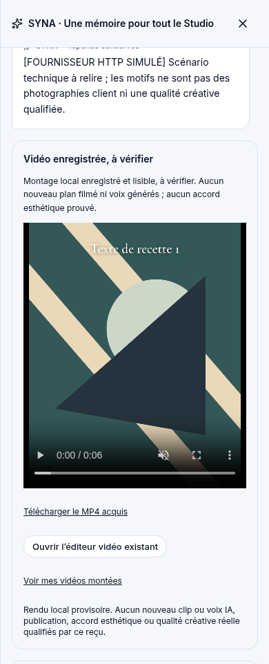
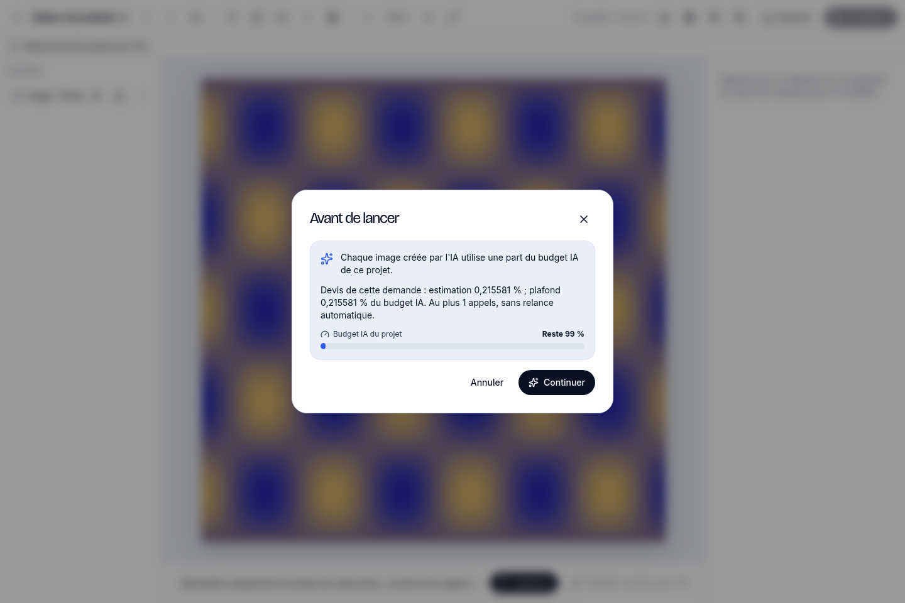

# SYNA FULL PARITY — résultats exécutés et convergence proposée

La parité totale n’est pas obtenue. La matrice [canonique](MATRICE-PARITE-301.md) distingue les opérations natives, leur raccordement SYNA et le degré de preuve. Aucun statut historique de #285 ne vaut résultat actuel.

## Sources et périmètre

- Recettes navigateur étendues : build production propre `5fd100d8129f352f5bf19c70da501be3e71b7b78`, copie isolée de #299 `7ca231aa` + seul correctif #300. Code applicatif identique au socle #302 `b515d5c7`, sans ses documents supplémentaires.
- Convergence proposée : copie indépendante de #299 `41931a5ec078267d53c8fc0e14b86f57ec7460e1` (suite de `ad5bffe6`), comprenant déjà #300 et les scripts de Claude. Aucun push sur cette branche Claude.
- Les preuves anciennes ne qualifient pas les correctifs plus récents ni les deux interfaces. Les cartes et sélecteurs ajoutés par Claude exigent une recette commune au SHA final.
- Données fictives, fournisseurs HTTP locaux ou SDK sentinelle, réseau fournisseur interdit. Zéro dépense réelle et aucune modification d’un projet client. Aucun merge dans main, déploiement, connexion ou publication externe.

## Parcours effectivement exécutés

Chaque recette passe par le navigateur, les handlers et les moteurs/worker réels avec stockage local, puis vérifie les résultats acquis. Les détails, empreintes des rapports sources et coûts **simulés** figurent dans [PREUVES-PARCOURS-5fd100d.json](PREUVES-PARCOURS-5fd100d.json). `allSimulatedTotals` est le total ; `simulatedTotals` ne couvre que le socle du harnais.

| Domaine | Résultat | Portée vérifiée / limite |
|---|---|---|
| Catalogue | PASS, quatre scènes | Mono, multi, inédit ; parcours services refusé. Fiches persistées, versions, reprise, export et panne simulée. |
| Contenus / Blog | PASS, deux / trois scènes | Devis, accord, génération, résultat relu, quota unique, réutilisation gratuite. Nouveau blog.edit #309 testé séparément. |
| Social / campagnes | PASS | Préparation, brouillons, calendrier et visuels ; panne simulée conserve l’acquis. Aucune publication externe. |
| Images | PASS, cinq scènes | Source/références, consentement, persistance, doublon et panne. Qualité créative fournisseur réelle non qualifiée. |
| Clips IA / voix | PASS | Fichiers réellement lisibles, versions, reprise sans second achat et corrections ciblées. Fournisseurs simulés. |
| Motion | PASS, quatre scènes | Montage local lisible, retouche, reprise et acquis. Aucun nouveau clip/voix IA ; 20 requêtes texte locales simulées sur la recette entière. |
| Site / composition / original | PASS | Source native, aperçu, rendus et ZIP réellement générés. Installation CMS et domaine réel non exécutés. |
| Stratégie / identité / logos | PASS | Choix et sélection, acquis et relecture ; sources fictives. Cette preuve précède le report financier explicite #315. |

Capture au SHA `5fd100d`, écran mobile : reçu « vidéo enregistrée, à vérifier », lecture et téléchargement du MP4 acquis. Les motifs sont des données de recette, aucune appréciation esthétique n’est revendiquée.

## Défauts démontrés et propositions indépendantes

| PR | Domaine | Correction / statut |
|---|---|---|
| #303 | SEO | Métadonnées acquises livrées sur une page existante sans document de corps ; rendu et ZIP vérifiés. |
| #304 | Stock | Version obligatoire, variante liée à sa fiche, transaction et invalidation des versions parent/variante. |
| #305 | Fichiers | Renommer/déplacer gratuitement : proposition, diff, confirmation, moteur natif, reçu et réessai. Carte UI à raccorder. |
| #306 | Versions métier | Versions strictement croissantes même à horloge identique ou rétrograde ; contrôle de concurrence préservé. |
| #307 | Images natives | Devis HMAC exact, accord distinct, plafond agrégé et vérification au worker. Deux parcours natifs desktop/mobile qualifiés séparément. |
| #308 | Demandes natives | Refus des reçus mensongers pour demande absente/étrangère ; synchronisation fiable de la fixture SMTP. |
| #309 | Blog acquis | Édition avec devis et accord, droits, source/version épinglées et écriture atomique document/article. |
| #310 | Contenus métier | Renommage bien/plat/réalisation et prix du plat, gratuits ; source exacte, effets natifs annoncés et reçu. CRUD complet absent du raccordement. |
| #311 | Harnais CI | Attend un message réellement enregistré, plus le texte encore dans textarea. Race reproduite par barrière POST ; assertions conservées et renforcées. |
| #312 | Recherche stock gratuite | allowGenerate:false force le mode sans IA et plafond nul côté serveur/worker. Résultat reste PROVISIONAL. |
| #313 | Ancien A1 | Whitelist locale site/fichiers ; lecture seule et interdiction IA préservées pour le reste. |
| #314 | Demande image | Sujet demandé conservé dans génération et relecture, empreinte exacte ; repli inchangé sans demande. |
| #315 | Logos | Report explicite du correctif économique #298, compatibilité #307 vérifiée ; aucune importation implicite dans Claude. |
| #316 | Images historiques | Ancien POST création sans devis compatible fermé en 409 ; V2, préparation et opérations gratuites conservées. |
| #317 | Retouche photo | Devis signé sur la source, accord, prix/plafond revérifiés avant fournisseur ; simple photo uniquement. |
| #318 | Recomposition créative | Achat bloqué tant qu’un devis compatible manque ; bouton existant désactivé. Reformatage gratuit préservé. |
| #319 | Demandes dans SYNA | Liste sans marquage puis sélection/diff/accord/reçu pour statut ; données entrantes isolées comme non fiables. Carte UI à raccorder. |
| #320 | Production sociale | Accord inférieur au devis serveur refusé avant queue et worker ; versions/plafonds/acquis conservés. |
| #321 | Retouche de texte native | Edition locale gratuite ; bascule payante exige devis et confirmation SYNA. |
| #322 | Classement natif | Règles locales gratuites, noms conservés ; filiation pipeline initial vérifiée pour son chemin existant. |
| #323 | Document publicitaire | ai_edit bloqué sans devis compatible ; toutes les opérations locales restent gratuites. |
| #324 | Bibliothèque de prompts | Exécution IA temporairement bloquée sans devis compatible ; copie, édition, favoris et remplissage préservés. |
| #325 | Création de texte native | Réemploi exact et local gratuits ; nouvelle acquisition IA exige devis, avant toute réservation quota/fournisseur. |

Les nombres ciblés sont publiés dans chaque PR ; ils se recouvrent et ne doivent pas être additionnés. Une suite de tests API ne remplace pas une carte opérationnelle testée dans Encre et Plein cadre.

## Sécurité financière et manques ouverts

L’[audit exécuté sur le snapshot 9268486](AUDIT-CONSENTEMENT-9268486.json) couvre huit endpoints et neuf opérations, avec vraie réservation et SDK sentinelle arrêté avant transport. Il prouve six écarts de consentement : cinq chemins sans accord financier et une production sociale acceptant zéro malgré un devis positif. Trois refus financiers fonctionnent. Les HTTP500 de ce rapport sont provoqués par la sentinelle ; ils ne démontrent pas un défaut HTTP500 du produit.

Les cinq chemins sans accord observé sont prompt-run, files.classify, création content.v2, fallback IA de content.v2.edit et adsdoc.ai_edit. Ils ne permettent pas de conclure à l’absence de plafonds : les réservations budgétaires étaient actives. Les correctifs ciblés ultérieurs doivent être attribués séparément.

Les fonctions locales et les acquis restent gratuits. Les recompositions complexes bloquées sont **CONNEXION OU CONSENTEMENT REQUIS**, jamais annoncées livrées. Les connexions/publications/paiements externes ne sont pas exécutés. Les opérations non exécutées restent NON TESTÉ dans la matrice ; ni déclaration d’adaptateur ni réponse de chat ne vaut preuve.

## Validation de convergence

Première union des correctifs #303–319 : typecheck réussi et **464 tests / 36 suites distinctes** réussis (305 + 159, fichiers sans chevauchement) sous garde réseau. Les deux échecs initiaux de CI #304/#310 sont suivis dans leurs PR ; aucun test supprimé ou skip ajouté. Les nouveaux correctifs et la CI complète exigent leur propre verdict au SHA final. Ce document ne vaut pas validation globale de la convergence.

Le correctif mobile de Claude `41931a5` est repris exactement dans la copie indépendante (trois fichiers : CSS, test et sélecteurs du harnais). Il place la barre basse sous les fenêtres natives ; aucune modification graphique supplémentaire de Codex. Les preuves antérieures ne qualifient pas ce nouveau socle.

## Preuves natives supplémentaires

- [UI #314](PREUVES-UI-NATIVE-314.json), source exacte `dc3c3a7` : produits desktop et vans/services mobile, sujet exact sur le transport, annulation, accord et résultat relu. Deux opérations natives coûtent 443 622 micro **simulés** ; harnais entier 467 358 micro simulés. Sept captures techniques. Aucune qualité créative fournisseur ni parité combinée déduite.
- [UI #317](PREUVES-UI-NATIVE-317.json), source exacte `785d516` : photo acquise, annulation sans appel/job, devis puis accord avec réponse perdue, reprise du même job, source inchangée, résultat version2 enregistré/rechargé. Une requête image SDK simulée, 58 239 micro contre plafond 92 700. Recadrage et reformatage par UI sans appel, usage ni job IA supplémentaires ; delta de réservations séparé non mesuré. Treize captures. Harnais entier : six appels HTTP simulés, 303 786 micro simulés. Refus aiPost complexe testé séparément par API.

## Fiabilité de publication et de recette

Les premières publications de #317/#319 ont été corrompues par un découpage mêlant positions en octets et lectures de caractères UTF-8. La CI l’a détecté ; sources locales qualifiées intactes. Elles sont réémises fidèlement (`785d516` / `81559e1`), avec arbre Git complet comparé à l’arbre attendu AVANT mise à jour de branche. L’historique des échecs reste visible. La publication de convergence applique cette même vérification.

La création native #325 a aussi fait l’objet d’un vrai test de réemploi en service avec deux offres et stratégie active. Un candidat non publié calculait le contexte avant la sélection du service ; la revue l’a détecté. Le contexte est désormais construit dans le moteur comme auparavant, et seule l’exécution est sous barrière IA. Le test exige contexte, document et version identiques sans nouvelle écriture.

Les incidents locaux ENOSPC sont attribués à l’espace de travail : suppression uniquement de caches Next inactifs et reproductibles, aucune source/preuve supprimée. La recette photo a ensuite été rejouée ; aucun défaut produit déduit de cette panne.

## Contrôles avant publication de convergence

Après intégration de #320–325 et des fixtures corrigées #304/#310 : **354 / 354 tests dans 24 fichiers**, sous garde réseau, maxWorkers2 (47,45 s). Typecheck final réussi et git diff --check réussi. C’est un sous-ensemble ciblé final, distinct des 464 tests antérieurs ; ne pas additionner ces suites qui se recouvrent. Logs locaux `/tmp/parity301-convergence-final-targeted.log` et `/tmp/parity301-convergence-final-types.log`.

#304 est corrigée au SHA `46ed3bb71a4536d671b1ff048d6716084d977e2f` (84 ciblés /3 suites), #310 au SHA `f3c1dc151a3916ca3084c8e896cae6e58fad09d6` (51 ciblés /3 suites). Seuls leurs tests sont modifiés, gardes conservées. Les CI complètes sont relancées sur ces nouvelles têtes, sans verdict présumé.

Les neuf payloads financiers historiques doivent encore être rejoués sur le SHA final de convergence. Les PR de gardes ont leurs preuves ciblées ; l’audit baseline n’est pas réétiqueté rétroactivement « corrigé ». Les autres opérations financières non exécutées restent NON_TESTE.

La confirmation indique le plafond serveur et un appel maximum. L’image floutée est un motif technique de recette ; l’acquis et la source sont vérifiés par SHA256 dans la preuve #317.

## Gel de la première convergence

Après correction du test historique de rédaction, **371 /371 tests dans 25 fichiers** passent ensemble sous garde réseau, maxWorkers2, 53,24 s (`/tmp/parity301-convergence-freeze-targeted.log`). Ce décompte remplace le sous-ensemble final354/24 ; il ne s’y ajoute pas.

Le nouveau SHA final de #325 est `52a02981663d02940ab81439a39c023144f8395b`, un fichier de test supplémentaire seulement : refus natif409 puis vrai parcours SYNA devis/accord/worker/reçu. Les consignes sont vérifiées dans le prompt ET le document ; le reçu acquired natif prouve la reprise gratuite avec tables coûts/jobs/versions strictement identiques. Aucun reçu de succès fabriqué.

CI complète supplémentaire désormais vérifiée verte pour #307 (`29a21dc`, run41524962394, tentative2 après disque runner plein) et #311 (`1d88e97`, run41528040359, première tentative). Chaque verdict inclut Docker, suite complète, recettes natives compilées et confirmation gratuite obligatoire. Il ne qualifie pas une autre tête.

La CI de convergence, le rejeu financier des neuf payloads et les six parcours Encre/Plein cadre seront attribués à la tête publiée, dans les commentaires de la PR et l’issue #301. Les valeurs pending de cette matrice sont le relevé à la création de la PR, pas une réussite anticipée.
