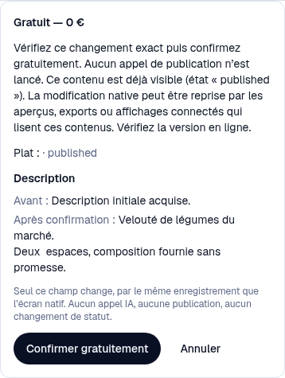
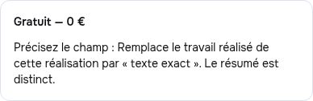
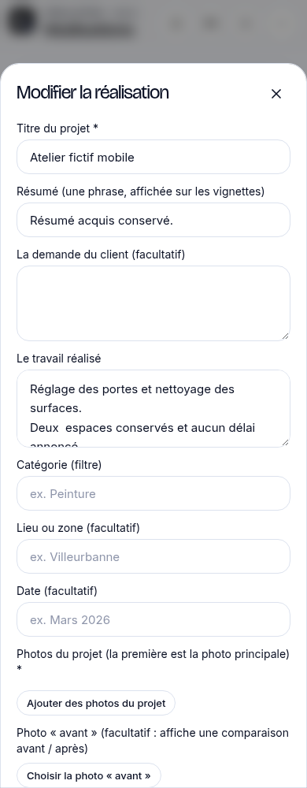

# Preuves complémentaires — sources séparées

Cette branche archive des preuves ; son code hérité ne constitue pas une nouvelle convergence applicative. Les SHA exécutés restent distincts.

- **#334 / 77a3614e** : quatre parcours réels description bien/plat et travail réalisé, Encre/Plein cadre, ordinateur/téléphone échantillonnés ; aperçu, accord, reçu, éditeur natif après vrai rechargement. Texte multiligne exact, avertissement du plat publié fictif local, ambiguïté refusée. 25 captures et quatre traces conservées ; trois captures sélectionnées ici. SDK et quatre tables financières à zéro. Les tests ciblés 83/83 et les limites métier restent décrits dans #334.
- **#331 / application 6fd99663** : quatre scènes Guide et quatre rechargements sur les mêmes projets ; 34 captures. Thème original raccordé mais fermé, plan vidéo absent. Lecture/actualisation/navigation/rechargement sans appel additionnel. Dix appels fournisseurs simulés au total : six de préparation, quatre réponses après devis/accord, 79 120 microeuros simulés ; zéro réel.
- **#333 / d6247c6e** : le backend CAS protège la correction humaine concurrente (409, aucune version/asset en trop). Un parcours a démontré un autre défaut client : le second onglet efface le cache partagé du premier, dont le brouillon reste visible avant reload mais n’est plus proposé après un vrai reload. Ce document conserve la preuve rouge ; aucune qualification de récupération complète n’est annoncée. Correctif client séparé en préparation, sans réappliquer automatiquement un vieux snapshot sur une nouvelle version.

Les JSON contiennent les sources, assertions, comptes et hashes des artefacts. Les CSS Google Fonts bloquées sont comptées séparément des appels IA. Aucun fournisseur réel, client, déploiement ou fusion dans main. La référence commune de vague 1 reste #326 c71369d1, CI complète verte ; les nouveaux domaines ont leurs propres branches et CI.

## Captures #334 relues

