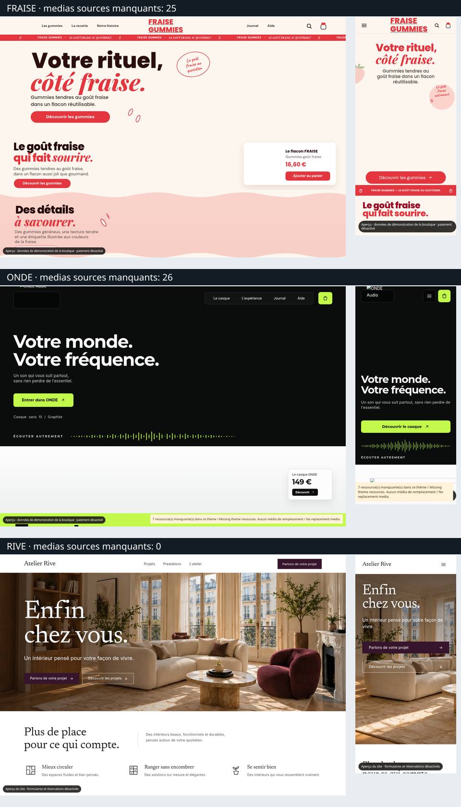
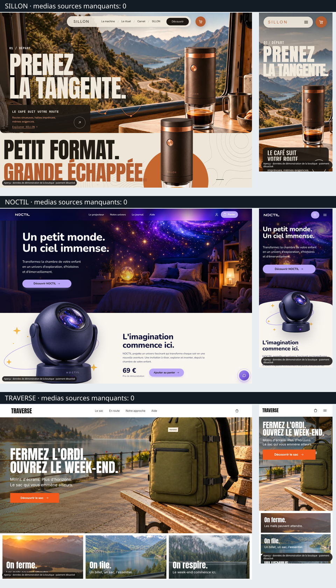
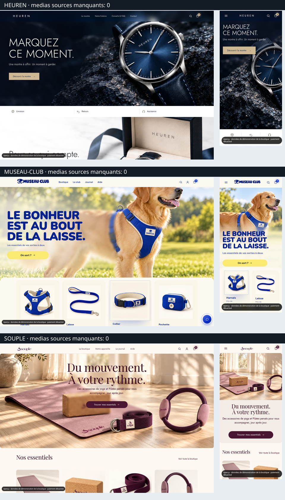
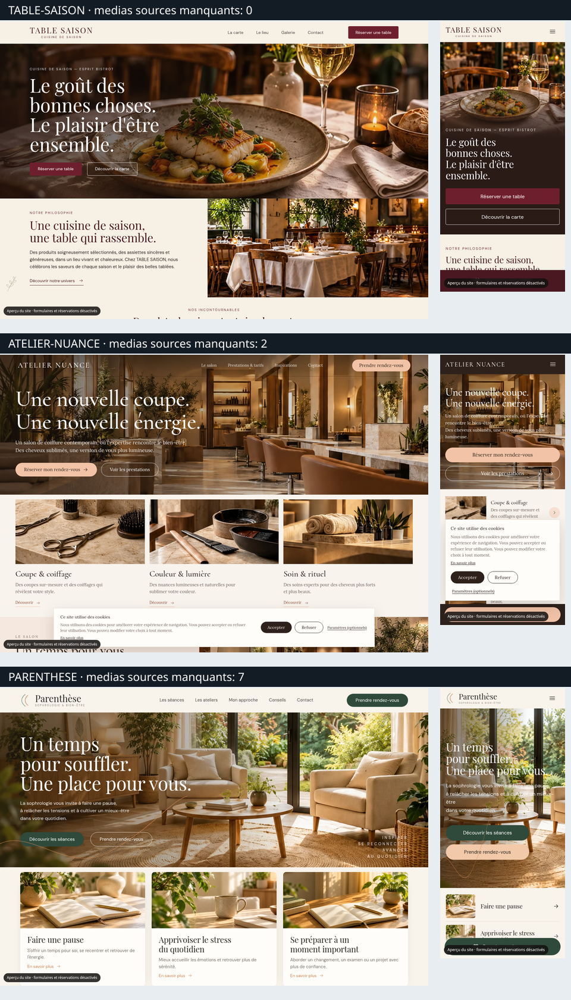
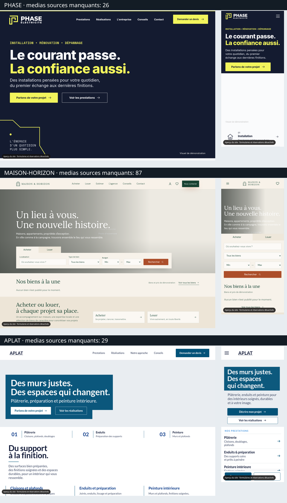

# Preuves de contre-vérification #195

**AVANT d38 et APRÈS main333bccc8 contrôlés : suite3395/0/31 et CI main vertes. [DERNIÈRE LIVRAISON APRÈS :814PNG,3vidéos,preuves et réserves](apres-main-333bccc8/README.md). Défaut FRAISE mobile préexistant signalé ; validation visuelle globale retenue, CMS réels et version du studio utilisateur non vérifiés. Les sections suivantes conservent les anciennes preuves avec leurs SHA.**

Données fictives exclusivement. Aucun fournisseur réel, paiement, e-mail externe, déploiement ni fusion. Les prix Higgsfield sont simulés et signalés dans les captures. Les pages ci-dessous appartiennent à des projets de recette séparés ; les clichés ne prouvent pas la qualité des kits privés absents.

## Captures des quinze accueils

Chaque lien donne le PNG natif lisible et téléchargeable. Les premiers écrans sont disponibles à côté des captures complètes (`*-premier-ecran.png`). La contre-mesure après décodage des images est dans [controle-medias-cadrage.json](navigateur/controle-medias-cadrage.json).

| Thème | Médias source absents | Ordinateur | Mobile |
|---|---:|---|---|
| fraise | 25 | [PNG complet](navigateur/fraise-ordinateur.png) | [PNG complet](navigateur/fraise-mobile.png) |
| onde | 26 | [PNG complet](navigateur/onde-ordinateur.png) | [PNG complet](navigateur/onde-mobile.png) |
| rive | 0 | [PNG complet](navigateur/rive-ordinateur.png) | [PNG complet](navigateur/rive-mobile.png) |
| sillon | 0 | [PNG complet](navigateur/sillon-ordinateur.png) | [PNG complet](navigateur/sillon-mobile.png) |
| noctil | 0 | [PNG complet](navigateur/noctil-ordinateur.png) | [PNG complet](navigateur/noctil-mobile.png) |
| traverse | 0 | [PNG complet](navigateur/traverse-ordinateur.png) | [PNG complet](navigateur/traverse-mobile.png) |
| heuren | 0 | [PNG complet](navigateur/heuren-ordinateur.png) | [PNG complet](navigateur/heuren-mobile.png) |
| museau-club | 0 | [PNG complet](navigateur/museau-club-ordinateur.png) | [PNG complet](navigateur/museau-club-mobile.png) |
| souple | 0 | [PNG complet](navigateur/souple-ordinateur.png) | [PNG complet](navigateur/souple-mobile.png) |
| table-saison | 0 | [PNG complet](navigateur/table-saison-ordinateur.png) | [PNG complet](navigateur/table-saison-mobile.png) |
| atelier-nuance | 2 | [PNG complet](navigateur/atelier-nuance-ordinateur.png) | [PNG complet](navigateur/atelier-nuance-mobile.png) |
| parenthese | 7 | [PNG complet](navigateur/parenthese-ordinateur.png) | [PNG complet](navigateur/parenthese-mobile.png) |
| phase | 26 | [PNG complet](navigateur/phase-ordinateur.png) | [PNG complet](navigateur/phase-mobile.png) |
| maison-horizon | 87 | [PNG complet](navigateur/maison-horizon-ordinateur.png) | [PNG complet](navigateur/maison-horizon-mobile.png) |
| aplat | 29 | [PNG complet](navigateur/aplat-ordinateur.png) | [PNG complet](navigateur/aplat-mobile.png) |

## Planches inspectées

Miniatures de contrôle réalisées à partir des captures natives. Les images complètes ci-dessus gardent leur résolution. Les médias absents sont explicitement comptés sur chaque ligne.

## Parcours natifs et vidéos

- [Résultat studio, catalogue sauvegardé/rechargé et autre métier](navigateur/resultat.json) ; [vidéo réelle du navigateur — téléchargement WebM](navigateur/parcours-studio-apercus.webm). Cette vidéo précède le contrôle final des cadrages et décodages ; les captures finales et le JSON de contre-mesure font foi pour ce contrôle.
- [Résultat sécurité, inscription/SMTP local, données personnelles, aperçus et panier](lot9/parcours.json) ; les 20 PNG sont dans [lot9](lot9/). Les reçus initiaux simulés sont dénombrés ; aucune nouvelle activité fournisseur n’est autorisée par le harnais.
- [Résultat administrateur Higgsfield](higgsfield/browser-result.json), [confirmation groupée](higgsfield/03-approbation-groupee-simulee.png), [mobile](higgsfield/05-admin-mobile-simule.png), [vidéo — téléchargement WebM](higgsfield/parcours-admin-simule.webm). **810 estimations fictives ; zéro prix réel de compte vérifié.**

## Exports et preuves techniques

- [Trois rejets PrestaShop natifs sous verrou exact](7f854218-rejets-prestashop-verrou-exact.json), à corriger ; aucun CMS installé dans cet environnement.
- [45 archives natives, inventaire et SHA-256](exports-consolides-7f854218.json) : ensemble préliminaire avant réinstallation des dépendances ; verdicts structurés seulement pour six thèmes. Un ZIP généré n’est ni une installation ni un achat vérifié. Les archives volumineuses ne sont pas toutes republiées.
- [Blocage Docker/CMS réellement constaté](cms-preparation-blocage.json).
- [Dépendances exactes](7f854218-dependances-exactes.json) et [écart de préparation documenté](dependances-preparation-ecart.json).
- [Manifestes SHA-256 des preuves](manifest.json). Les logs des échecs de préparation et leurs retests sont conservés, jamais annoncés verts.

## Rejouer les harnais

Utiliser une copie isolée sans `.env` ni `.env.local`, jamais le dossier du studio/client. Le candidat exact et ses dépendances sont indiqués dans le rapport. Le `npm ci` CPU local utilise l’option officielle `npm_config_onnxruntime_node_install_cuda=skip` ; le verrou reste inchangé. Les tests fournisseurs doivent garder le preload `scripts/lot9/network-guard.mjs`.

Les fichiers de [harnais](harnais/) sont des copies de preuve ; placer chaque copie dans son emplacement prévu sous `scripts/` (et le harnais de sécurité sous `scripts/lot9/`) pour conserver ses imports relatifs. Les extensions `.ts.txt` / `.mts.txt` doivent retrouver `.ts` / `.mts`. Ne remplacer aucun fichier existant : les noms `contre-verification-195-*` sont dédiés. Le harnais de sécurité crée lui-même sa base fictive et un serveur Next sur loopback, puis les arrête ; il refuse une configuration client préexistante. Pour les autres harnais, n’utiliser qu’un `DATA_DIR` commençant par `/tmp/ecs-higgsfield-proof-195-` et le réseau simulé séparé `scripts/higgsfield-proof-network.mjs`. Lancer le serveur web seul, sans worker.

Les adaptations du harnais historique sont expliquées dans le [rapport](../../docs/coordination/CONTRE_VERIFICATION_195.md) : fixture native renommée et garde stricte contre tout nouvel appel, même simulé. Le contrôle média remet le défilement instantanément à zéro et attend le décodage avant capture. Les jetons signés fictifs ont été expurgés des références exportées ; aucune session/clé/base n’est incluse.

## Correctif PrestaShop et formulaire APLAT — nouveau candidat 3a

- [57 contrôles ciblés réussis](3ae89a6d-cibles.log.txt), contre [6 échecs attendus de la même nouvelle contre-épreuve sur l’ancien moteur](7f854218-exports-scripts-contre-epreuve-rouge.log.txt).
- [17 exports PrestaShop, gates natifs complets](3ae89a6d-exports-17-prestashop.json) : tous PROVISIONAL ; pas de faux rejet, pas de qualification d’installation ou de qualité photographique complète.
- [38 interactions APLAT](aplat-3ae89a6d/resultat.json), [étape 2 du devis](aplat-3ae89a6d/03-devis-mobile-etape2.png), [vidéo de la démonstration](aplat-3ae89a6d/aplat-devis-demo.webm).
- [Mode non démonstration, un seul POST local et aucune fausse confirmation](aplat-3ae89a6d/mode-nondemo.json) ; [capture avant POST](aplat-3ae89a6d/05-mode-nondemo-avant-post-local.png), [récepteur local sans e-mail](aplat-3ae89a6d/06-recepteur-local-sans-email.png). Le serveur ne transmet rien à un CMS ou à un destinataire.
- [SHA du build effectivement servi sur loopback, accès anonyme refusé](3ae89a6d-production-http.json). Le studio réel de Thomas n’a pas été modifié.
- [PHP CLI isolé et empreintes des paquets](php-cli-isole.json), [9 tests réels du moteur PHP exporté](3ae89a6d-php-native-smoke.log.txt). Aucun paquet système installé et aucun CMS créé par ces commandes.

Les six nouvelles captures et la vidéo APLAT n’emportent pas les 29 médias privés absents : elles attestent les interactions et la configuration du formulaire. La version sans démonstration est uniquement rendue et reçue sur loopback, sans publication. Les limites CMS et photo restent ouvertes.

## Verdict AVANT et preuves finales 3a

- [Suite complète, synthèse machine](3ae89a6d-suite-synthese.json) ; [journal](3ae89a6d-suite.log.txt).
- [64 contrôles HTTP natifs, sauvegarde et isolation](3ae89a6d-http-matrice-64.json).
- [CI, identité du candidat et registre des apports](3ae89a6d-github-candidat-ci-registre.json).
- [Pilote sept jours, 63 réussites](3ae89a6d-autopilot-7jours.log.txt).
- Migrations/restaurations 3a : [dcfc13b1](migration-dcfc13b1-3ae89a6d.json), [d97e0b95](migration-d97e0b95-3ae89a6d.json), [main 0a](migration-0a6aa1dd-3ae89a6d.json).

Tous les éléments sont attribués à leur SHA. Aucun résultat avant fusion ne vaut contrôle après fusion ni mise à jour du studio réel.

## Éditeur natif 3a et réouverture

[Résultat produit/service](editeur-3ae89a6d/resultat.json), [matrice par point et par fichier testé](3ae89a6d-verdict-par-point.json).

| Projet fictif | Ordinateur | Mobile |
|---|---|---|
| Théière en grès | [PNG](editeur-3ae89a6d/produit-ordinateur.png) | [PNG](editeur-3ae89a6d/produit-mobile.png) |
| Cours de tournage | [PNG](editeur-3ae89a6d/service-ordinateur.png) | [PNG](editeur-3ae89a6d/service-mobile.png) |

Suivi P2 existant : [menu de section masquée, preuve machine](editeur-3ae89a6d/menu-section-masquee.json), [capture](editeur-3ae89a6d/menu-section-masquee.png). Les parcours réussis n’annulent pas ce défaut limité aux sections masquées. Les préparations incorrectes du harnais sont conservées dans les journaux, sans modification de l’application ni de la sandbox.

## CI finale et compléments

- [Échec observé de la CI96ad, extrait et compteurs](96ad41b3-ci-echec-affiche.json).
- [37 publications natives : photo exacte et calques, zéro appel ajouté](affiches-3ae89a6d/resultat.json). Rendus inspectés localement ; seule cette métrique fermée est publiée pour cette fixture.
- [17 exports Woo/WordPress et17Shopify natifs PROVISIONAL, décisions intégrales](3ae89a6d-exports-17-woo-shopify.json). Aucun parcours réel CMS.
- Test corrigé par Claude en d38 ; [6/6 natifs](d38b0b7c-affiches.log.txt). Suite et CI en cours, pas encore de nouveau feu vert.

## Suite indépendante d38 terminée

[3 395 réussites,0échec,31ignorés — synthèse par fichier](d38b0b7c-suite-synthese.json), [journal](d38b0b7c-suite.log.txt), [processus et commande exacts](d38b0b7c-suite-execution.json). Types réussis. CI finale encore en cours ; ne pas confondre cette réussite locale avec un accord de fusion déjà renouvelé.

## Accord AVANT final d38

[CI finale, identité du checkout et étapes terminées](d38b0b7c-ci-identite.json), [suite indépendante](d38b0b7c-suite-synthese.json). Le rouge96ad est conservé avec sa cause et la correction contre-vérifiée ; il n’est pas présenté comme un vert. Main réel et contrôle APRÈS encore en attente.

## Seconde passe sur le vrai main333bccc8

[Présence des apports et identité de l’arbre](main-333bccc8-preservation.json), [build natif](main-333bccc8-build-execution.json), [types](main-333bccc8-types-execution.json). Journaux et sorties associés dans ce dossier. [Vraie CI push main40295873897](https://github.com/spacedevelopment01-max/Ecom-studio-ia/actions/runs/40295873897) en cours ; pas encore de verdict APRÈS.
