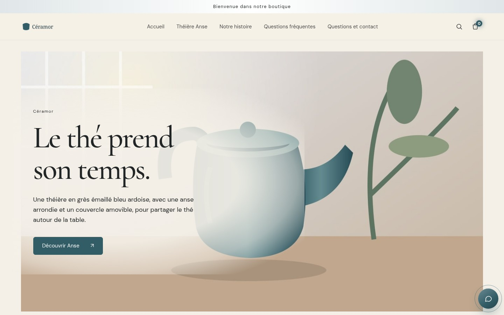
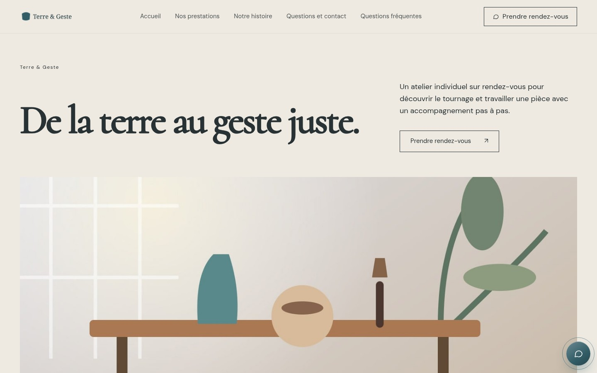
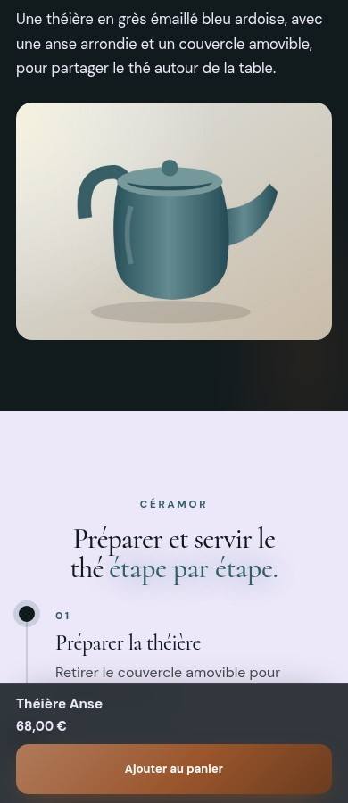

# Réception #154 — preuves de la PR #156

Code du studio testé : `393dc83555193855d8803d08ca28dcfa825296dc`. Serveur compilé local, comptes fictifs isolés. Aucune mise à jour du studio client, fusion, connexion CMS, commande, RDV ou génération payante.

**Les illustrations client sont des fixtures locales décodables. Elles ne certifient pas la qualité créative d’un fournisseur.** Les références photographiques originales restent celles de Claude ; leurs compositions ne sont pas redessinées. Les kits originaux FRAISE/ONDE manquent (9 fichiers chacun).

[Rapport et matrice demande → changement → preuve](../../docs/coordination/ISSUE_154_RESULTATS.md) · [93 contrôles navigateur](preuves/navigateur.json) · [8 contrôles prestation/contact](preuves/services-pages.json) · [Matrice de contenu](preuves/content-matrix.json) · [Ascendances et empreinte artistique](preuves/integration.json)

## Captures complètes : client face à la référence

Chaque lien ouvre une capture entière en résolution native. Les images mobiles très longues sont à ouvrir pour lire les textes. Les viewports plus bas permettent une lecture immédiate.

| Profil | Client ordinateur | Client mobile | Référence ordinateur | Référence mobile |
|---|---|---|---|---|
| FRAISE | [accueil](captures/fraise-client-accueil-1440.jpg) · [produit](captures/fraise-client-produit-1440.jpg) | [accueil](captures/fraise-client-accueil-390.jpg) · [produit](captures/fraise-client-produit-390.jpg) | Kit absent | Kit absent |
| ONDE | [accueil](captures/onde-client-accueil-1440.jpg) · [produit](captures/onde-client-produit-1440.jpg) | [accueil](captures/onde-client-accueil-390.jpg) · [produit](captures/onde-client-produit-390.jpg) | Kit absent | Kit absent |
| ORBE | [accueil](captures/orbe-client-accueil-1440.jpg) · [produit](captures/orbe-client-produit-1440.jpg) | [accueil](captures/orbe-client-accueil-390.jpg) · [produit](captures/orbe-client-produit-390.jpg) | [accueil](captures/orbe-reference-accueil-1440.jpg) · [produit](captures/orbe-reference-produit-1440.jpg) | [accueil](captures/orbe-reference-accueil-390.jpg) · [produit](captures/orbe-reference-produit-390.jpg) |
| RIVE | [accueil](captures/rive-client-accueil-1440.jpg) | [accueil](captures/rive-client-accueil-390.jpg) | [accueil](captures/rive-reference-accueil-1440.jpg) | [accueil](captures/rive-reference-accueil-390.jpg) |
| SILLON | [accueil](captures/sillon-client-accueil-1440.jpg) · [produit](captures/sillon-client-produit-1440.jpg) | [accueil](captures/sillon-client-accueil-390.jpg) · [produit](captures/sillon-client-produit-390.jpg) | [accueil](captures/sillon-reference-accueil-1440.jpg) · [produit](captures/sillon-reference-produit-1440.jpg) | [accueil](captures/sillon-reference-accueil-390.jpg) · [produit](captures/sillon-reference-produit-390.jpg) |
| NOCTIL | [accueil](captures/noctil-client-accueil-1440.jpg) · [produit](captures/noctil-client-produit-1440.jpg) | [accueil](captures/noctil-client-accueil-390.jpg) · [produit](captures/noctil-client-produit-390.jpg) | [accueil](captures/noctil-reference-accueil-1440.jpg) · [produit](captures/noctil-reference-produit-1440.jpg) | [accueil](captures/noctil-reference-accueil-390.jpg) · [produit](captures/noctil-reference-produit-390.jpg) |
| TRAVERSE | [accueil](captures/traverse-client-accueil-1440.jpg) · [produit](captures/traverse-client-produit-1440.jpg) | [accueil](captures/traverse-client-accueil-390.jpg) · [produit](captures/traverse-client-produit-390.jpg) | [accueil](captures/traverse-reference-accueil-1440.jpg) · [produit](captures/traverse-reference-produit-1440.jpg) | [accueil](captures/traverse-reference-accueil-390.jpg) · [produit](captures/traverse-reference-produit-390.jpg) |
| TRAVERSE-INCOMPLET | [accueil](captures/traverse-incomplet-client-accueil-1440.jpg) · [produit](captures/traverse-incomplet-client-produit-1440.jpg) | [accueil](captures/traverse-incomplet-client-accueil-390.jpg) · [produit](captures/traverse-incomplet-client-produit-390.jpg) | Même référence TRAVERSE | Même référence TRAVERSE |

| Service RIVE | Client ordinateur | Client mobile | Référence ordinateur | Référence mobile |
|---|---|---|---|---|
| prestations | [prestations](captures/rive-client-prestations-1440.jpg) | [prestations](captures/rive-client-prestations-390.jpg) | [prestations](captures/rive-reference-prestations-1440.jpg) | [prestations](captures/rive-reference-prestations-390.jpg) |
| contact | [contact](captures/rive-client-contact-1440.jpg) | [contact](captures/rive-client-contact-390.jpg) | [contact](captures/rive-reference-contact-1440.jpg) | [contact](captures/rive-reference-contact-390.jpg) |

## Viewports lisibles

Client Céramor, composition ORBE, image de test et identité propres au projet :

Service Terre & Geste, composition RIVE :

NOCTIL mobile, milieu de fiche, barre d’achat dans son viewport réel :

[Éditeur partiel ordinateur](captures/studio-adaptation-partielle-1440.jpg) · [Nouvelle session mobile, onglet Structure](captures/studio-nouvelle-session-390.jpg) · [Démo originale avant choix](captures/01-demo-originale-avant-choix.jpg) · [Client après choix explicite](captures/02-projet-client-apres-choix.jpg)

## Vidéos réelles des interactions

Enregistrements Chromium convertis localement en MP4, sans génération vidéo IA. Clics et défilement réels ; panier d’aperçu uniquement, aucun paiement.

- [Démo originale → choix → worker → éditeur → téléchargements](videos/choix-demo-adaptation-exports.mp4?raw=true)
- [Retouche native et rechargement de l’éditeur](videos/studio-retouche-reprise.mp4?raw=true)
- [NOCTIL : scroll, zoom, panier et FAQ](videos/noctil-interactions.mp4?raw=true)
- [TRAVERSE : scroll, zoom, panier et FAQ](videos/traverse-interactions.mp4?raw=true)
- [RIVE : scroll, FAQ et navigation vers la prise de contact](videos/rive-interactions.mp4?raw=true)

## Barre mobile NOCTIL / TRAVERSE

36 observations à 360/390/430 px, aucun débordement horizontal. La barre apparaît après le bloc principal et disparaît devant le menu et le footer. Le focus avec viewport de hauteur 500 simule le clavier ; aucun appareil physique testé. La superposition visible sur une capture pleine page ne prouve pas une obstruction dans la navigation réelle. Aucune modification artistique apportée.

[Mesures détaillées](preuves/barre-mobile.json)

| Profil / largeur | Détails | Menu ouvert | Champ et viewport réduit | Footer |
|---|---|---|---|---|
| noctil 360 | [details](captures/barre-noctil-360-details.jpg) | [menu](captures/barre-noctil-360-menu.jpg) | [focused-resized-viewport](captures/barre-noctil-360-focused-resized-viewport.jpg) | [footer](captures/barre-noctil-360-footer.jpg) |
| noctil 390 | [details](captures/barre-noctil-390-details.jpg) | [menu](captures/barre-noctil-390-menu.jpg) | [focused-resized-viewport](captures/barre-noctil-390-focused-resized-viewport.jpg) | [footer](captures/barre-noctil-390-footer.jpg) |
| noctil 430 | [details](captures/barre-noctil-430-details.jpg) | [menu](captures/barre-noctil-430-menu.jpg) | [focused-resized-viewport](captures/barre-noctil-430-focused-resized-viewport.jpg) | [footer](captures/barre-noctil-430-footer.jpg) |
| traverse 360 | [details](captures/barre-traverse-360-details.jpg) | [menu](captures/barre-traverse-360-menu.jpg) | [focused-resized-viewport](captures/barre-traverse-360-focused-resized-viewport.jpg) | [footer](captures/barre-traverse-360-footer.jpg) |
| traverse 390 | [details](captures/barre-traverse-390-details.jpg) | [menu](captures/barre-traverse-390-menu.jpg) | [focused-resized-viewport](captures/barre-traverse-390-focused-resized-viewport.jpg) | [footer](captures/barre-traverse-390-footer.jpg) |
| traverse 430 | [details](captures/barre-traverse-430-details.jpg) | [menu](captures/barre-traverse-430-menu.jpg) | [focused-resized-viewport](captures/barre-traverse-430-focused-resized-viewport.jpg) | [footer](captures/barre-traverse-430-footer.jpg) |

## ZIP réellement téléchargés / exportés

Les six exemples ci-dessous contiennent les médias fictifs et `adaptation-client.json`. Ils restent provisoires ; aucune installation CMS réelle n’est revendiquée.

| Projet | Shopify | WooCommerce | PrestaShop |
|---|---|---|---|
| Produit, parcours API natif | [ZIP](exports/client-orbe-shopify.zip?raw=true) | [ZIP](exports/client-orbe-woocommerce.zip?raw=true) | [ZIP](exports/client-orbe-prestashop.zip?raw=true) |
| Service, export natif | [ZIP](exports/rive-shopify.zip?raw=true) | [ZIP](exports/rive-woocommerce.zip?raw=true) | [ZIP](exports/rive-prestashop.zip?raw=true) |

[Résultats des 35 paquets et leurs SHA-256](preuves/exports.json) : les cinq plateformes existantes sont couvertes. Shopify Theme Check officiel ; PHP livré pour WooCommerce ; HTML/CSS/JS réellement exportés pour PrestaShop. Wix/Squarespace restent des paquets à monter dans leurs éditeurs.

## Vérifications et limites

[140 tests ciblés](logs/mission154-targets-final.txt) · [25 cas Theme Check rapide](logs/mission154-themecheck-final.txt) · [Build compilé](logs/mission154-build-final.txt) · [Parcours natif sans écriture avant choix](preuves/parcours-initial.json) · [Conservation des acquisitions](preuves/reprise-engine.json)

Les états partiels correspondent aux vrais manques (avis, mesures, comparatifs, hotspots, mentions, consentement newsletter). Aucun de ces faits n’est inventé pour rendre le tableau vert. Le cas incomplet conserve 17 demandes de médias préparées, sans les exécuter.

La validation finale attend encore les générations autorisées en conditions réelles, les photos originales FRAISE/ONDE et, selon la cible, une installation CMS et des appareils mobiles physiques. Ces limites ne sont pas masquées par les tests simulés.

## Pages réconciliées après reprise

Les pages générées anciennes ne remplacent plus les pages adaptées. Les mentions absentes restent à compléter, avec titre lisible, sans faux texte juridique.

[Avant : neuf pages sans titre](preuves/reprise-pages-avant.json) · [Après : réponses 200 et H1](preuves/pages-legales.json)

[Confidentialité mobile](captures/fraise-confidentialite-client-390.jpg) · [Conditions ordinateur](captures/fraise-conditions-generales-client-1440.jpg) · [Mentions du service mobile](captures/rive-mentions-legales-client-390.jpg) · [Livraison ordinateur](captures/fraise-livraison-retours-client-1440.jpg)
