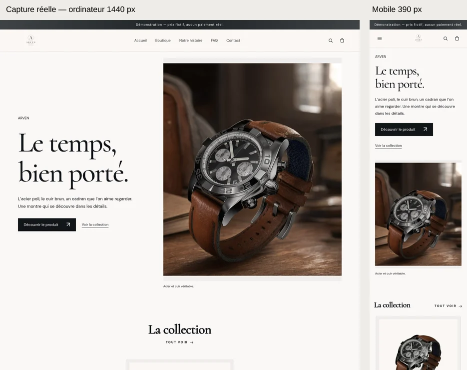
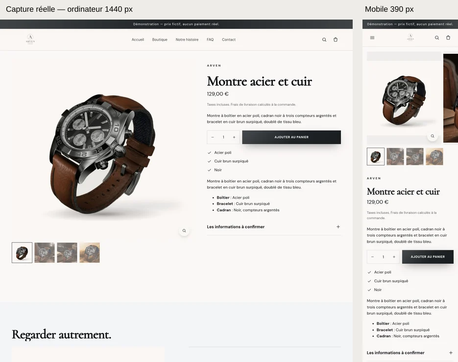
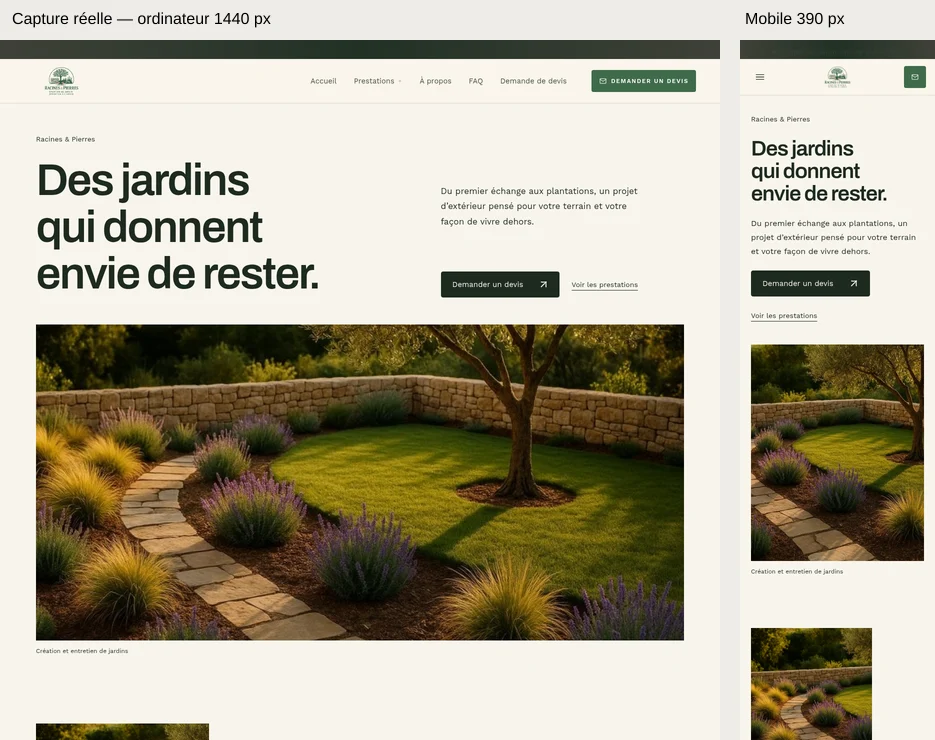
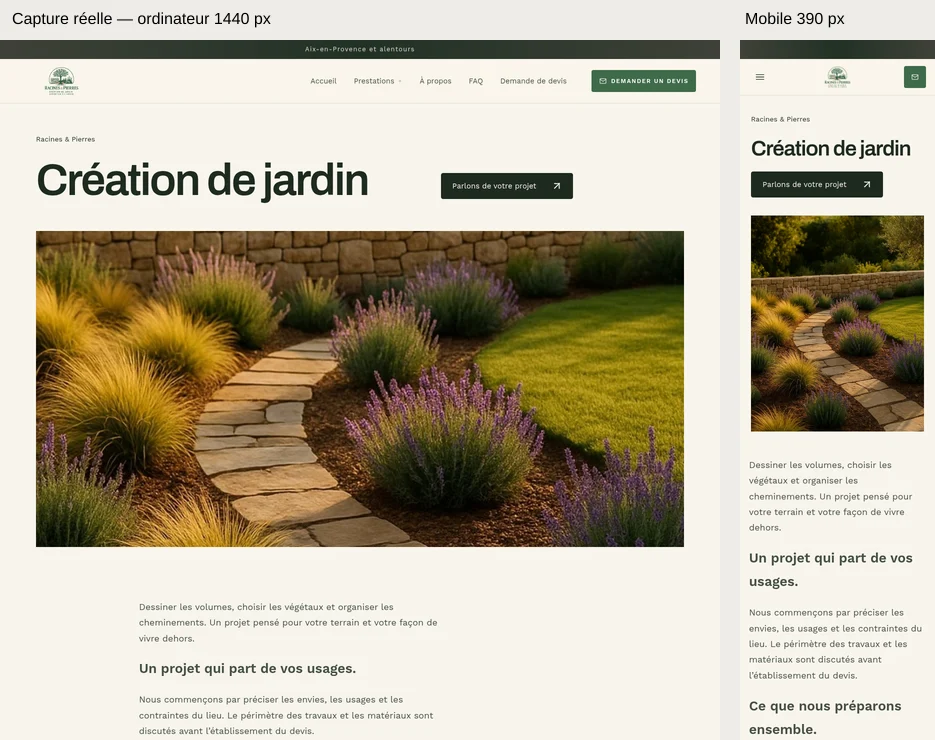

# Lot 2A — preuves visuelles réelles

Source des thèmes et du script : [4097eec6ae5a6d6361093219e11afc2fc0abdb0a](https://github.com/spacedevelopment01-max/Ecom-studio-ia/tree/4097eec6ae5a6d6361093219e11afc2fc0abdb0a). Code propre au lancement.

Rendus des routes d’aperçu réelles du studio ; projets de test isolés ; zéro appel IA. Ces propositions restent à valider visuellement. Aucun CMS installé, aucun paiement ni message commercial envoyé.

Les aperçus ci-dessous rapprochent les hauts de pages. **Chaque lien PNG mène au fichier intégral original, sans compression avec perte.** Les largeurs 1440 / 390 sont celles du navigateur ; les hauteurs des pages complètes varient. Les contrôles intermédiaires à 768 / 1024 sont dans [preuves.json](preuves.json).

## Vitrine

| Vue | Taille originale | PNG original |
|---|---|---|
| Accueil intégral — mobile | 390 × 7232 | [Télécharger](products/accueil-mobile.png) |
| Accueil intégral — ordinateur | 1440 × 6468 | [Télécharger](products/accueil-ordinateur.png) |
| Ouverture et en-tête — mobile | 390 × 844 | [Télécharger](products/entete-mobile.png) |
| Ouverture et en-tête — ordinateur | 1440 × 900 | [Télécharger](products/entete-ordinateur.png) |
| Pied de page rapproché — mobile | 390 × 1172 | [Télécharger](products/pied-mobile.png) |
| Pied de page rapproché — ordinateur | 1440 × 740 | [Télécharger](products/pied-ordinateur.png) |
| Fiche produit intégrale — mobile | 390 × 4884 | [Télécharger](products/produit-mobile.png) |
| Fiche produit intégrale — ordinateur | 1440 × 3993 | [Télécharger](products/produit-ordinateur.png) |
| Reportage rapproché — mobile | 390 × 645 | [Télécharger](products/section-mobile.png) |
| Reportage rapproché — ordinateur | 1440 × 807 | [Télécharger](products/section-ordinateur.png) |

Vidéos réelles : [lecture MP4](products/parcours.mp4) · [source native WebM](products/parcours.webm).

Exports à examiner : [Shopify](products/shopify.zip) · [WordPress / WooCommerce](products/woocommerce.zip) · [PrestaShop](products/prestashop.zip).

[Modèle exact](products/theme-spec.json) · [Pages à créer et affecter manuellement dans Shopify](products/pages-a-creer.json) · [Provenance des médias](products/provenance-medias.json) · [CSV produits de démonstration](products/produits.csv).

## Jardin

| Vue | Taille originale | PNG original |
|---|---|---|
| Accueil intégral — mobile | 390 × 8698 | [Télécharger](services/accueil-mobile.png) |
| Accueil intégral — ordinateur | 1440 × 7953 | [Télécharger](services/accueil-ordinateur.png) |
| Ouverture et en-tête — mobile | 390 × 844 | [Télécharger](services/entete-mobile.png) |
| Ouverture et en-tête — ordinateur | 1440 × 900 | [Télécharger](services/entete-ordinateur.png) |
| Pied de page rapproché — mobile | 390 × 1145 | [Télécharger](services/pied-mobile.png) |
| Pied de page rapproché — ordinateur | 1440 × 873 | [Télécharger](services/pied-ordinateur.png) |
| Détail de prestation intégral — mobile | 390 × 2899 | [Télécharger](services/prestation-mobile.png) |
| Détail de prestation intégral — ordinateur | 1440 × 2615 | [Télécharger](services/prestation-ordinateur.png) |
| Reportage rapproché — mobile | 390 × 662 | [Télécharger](services/section-mobile.png) |
| Reportage rapproché — ordinateur | 1440 × 593 | [Télécharger](services/section-ordinateur.png) |

Vidéos réelles : [lecture MP4](services/parcours.mp4) · [source native WebM](services/parcours.webm).

Exports à examiner : [Shopify](services/shopify.zip) · [WordPress / WooCommerce](services/woocommerce.zip) · [PrestaShop](services/prestashop.zip).

[Modèle exact](services/theme-spec.json) · [Pages à créer et affecter manuellement dans Shopify](services/pages-a-creer.json) · [Provenance des médias](services/provenance-medias.json).

## Contrôles et limites

[Relevé navigateur](preuves.json) · [Contrôle officiel des ZIP réellement livrés](export-check.json) · [Couleurs exportées](contrastes.json) · [Métadonnées des fichiers](fichiers.json) · [Empreintes](SHA256SUMS).

Le ZIP Shopify ne crée pas le catalogue ni les pages et n’affecte pas les gabarits aux produits par l’import CSV : suivre le manifeste `assets/es-product-templates.json` et préparer les pages indiquées. Installation réelle non vérifiée. WooCommerce et PrestaShop utilisent une fiche produit native partagée : les dispositions par produit sont dégradées et signalées. Le formulaire de devis a été rempli et sa validation testée ; aucun envoi réel n’est revendiqué.

Les mesures de performance sont locales, sous charge, sans score Lighthouse ni extrapolation en production. Resource Timing peut être indisponible dans l’origine opaque du bac à sable : une valeur nulle ne signifie pas zéro trafic.

Voir [le rapport complet de la branche](https://github.com/spacedevelopment01-max/Ecom-studio-ia/blob/codex/lot-2a-themes-reference/docs/coordination/LOT_2A_THEMES_RESULTATS.md) pour les commandes, échecs intermédiaires et résultats finaux.
