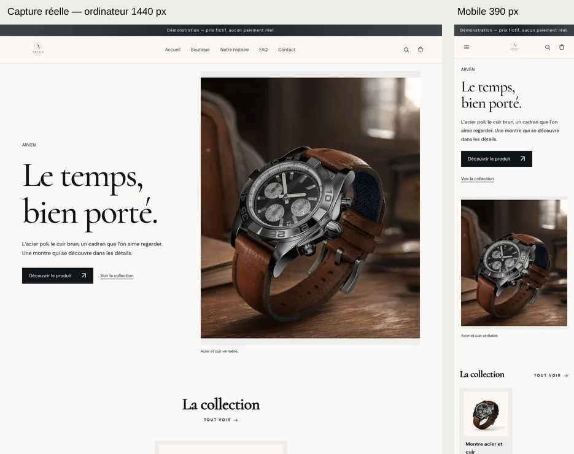
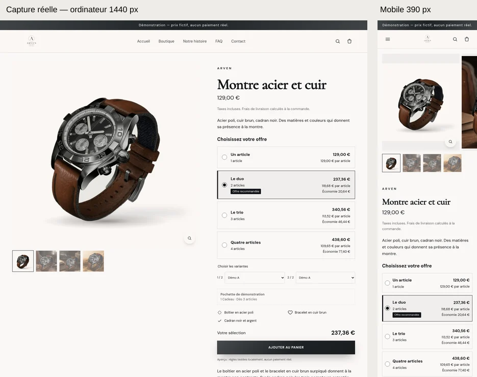
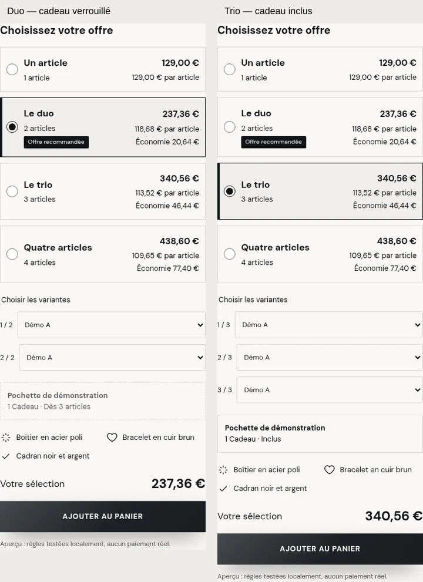
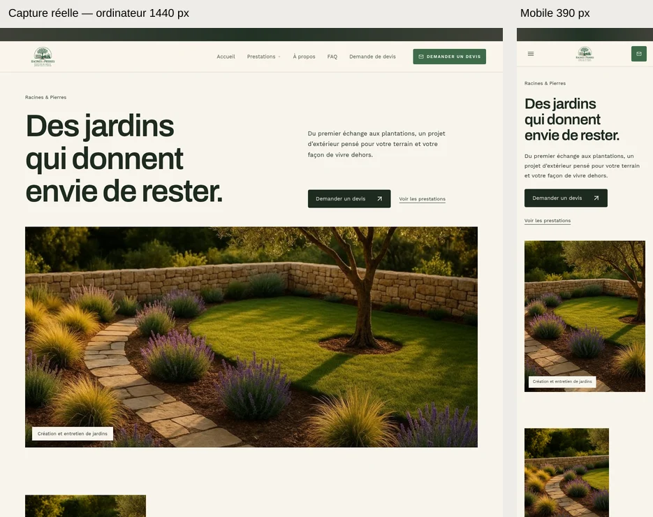
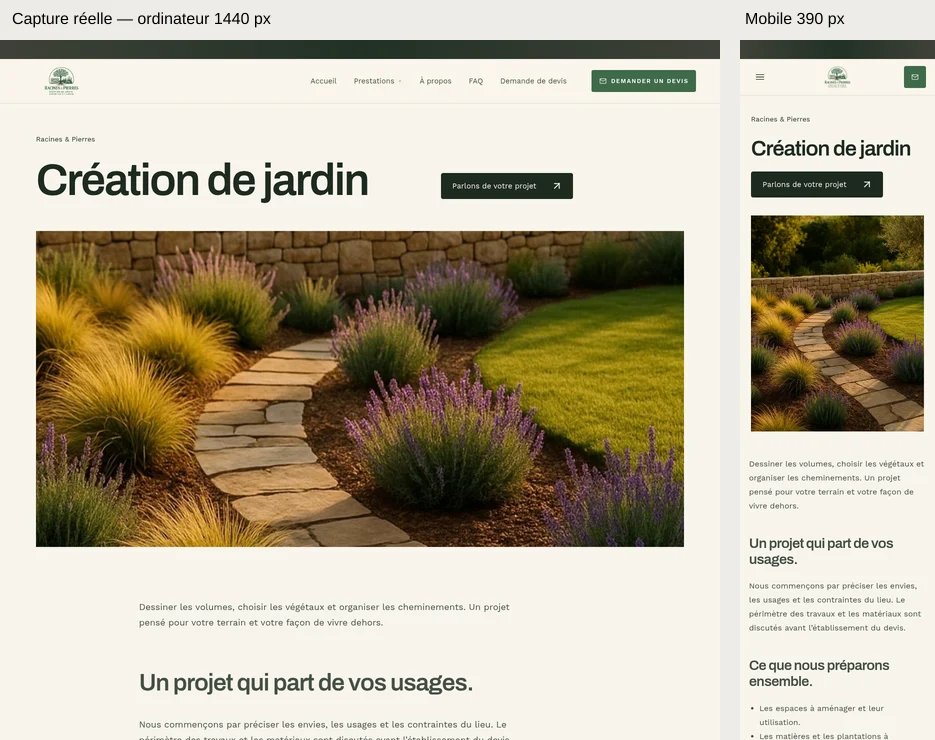

# Lot 2A — deux références améliorées, passe du 18 octobre 2026

Code réellement rendu : `f40ef52dca145344d9972cf14727eeba6c992588`. Sources inchangées pendant la capture. Aucun paiement réel, CMS installé ou appel IA dans cette recette.

Les liens « PNG original » et les vidéos ouvrent les fichiers téléchargeables. Les aperçus WebP sont séparés : haut de page comparé, pas la page entière. Les originaux PNG restent intacts. Dans une adresse GitHub au commit livré, les liens relatifs gardent ce même commit.

## Vitrine — vente de produits

| Capture | Dimensions | Fichier original |
|---|---|---|
| accueil-mobile | 390 × 7066 | [PNG original](products/accueil-mobile.png?raw=1) |
| accueil-ordinateur | 1440 × 6467 | [PNG original](products/accueil-ordinateur.png?raw=1) |
| achat-1-mobile | 354 × 850 | [PNG original](products/achat-1-mobile.png?raw=1) |
| achat-1-ordinateur | 541 × 886 | [PNG original](products/achat-1-ordinateur.png?raw=1) |
| achat-2-mobile | 354 × 906 | [PNG original](products/achat-2-mobile.png?raw=1) |
| achat-2-ordinateur | 541 × 886 | [PNG original](products/achat-2-ordinateur.png?raw=1) |
| achat-3-mobile | 354 × 962 | [PNG original](products/achat-3-mobile.png?raw=1) |
| achat-3-ordinateur | 541 × 942 | [PNG original](products/achat-3-ordinateur.png?raw=1) |
| achat-cadeau-indisponible-mobile | 354 × 962 | [PNG original](products/achat-cadeau-indisponible-mobile.png?raw=1) |
| entete-mobile | 390 × 844 | [PNG original](products/entete-mobile.png?raw=1) |
| entete-ordinateur | 1440 × 900 | [PNG original](products/entete-ordinateur.png?raw=1) |
| panier-duo-mobile | 390 × 1908 | [PNG original](products/panier-duo-mobile.png?raw=1) |
| panier-duo-ordinateur | 1440 × 1394 | [PNG original](products/panier-duo-ordinateur.png?raw=1) |
| panier-trio-mobile | 390 × 2092 | [PNG original](products/panier-trio-mobile.png?raw=1) |
| panier-trio-ordinateur | 1440 × 1408 | [PNG original](products/panier-trio-ordinateur.png?raw=1) |
| pied-mobile | 390 × 1150 | [PNG original](products/pied-mobile.png?raw=1) |
| pied-ordinateur | 1440 × 739 | [PNG original](products/pied-ordinateur.png?raw=1) |
| produit-mobile | 390 × 5627 | [PNG original](products/produit-mobile.png?raw=1) |
| produit-ordinateur | 1440 × 4527 | [PNG original](products/produit-ordinateur.png?raw=1) |
| section-mobile | 390 × 646 | [PNG original](products/section-mobile.png?raw=1) |
| section-ordinateur | 1440 × 807 | [PNG original](products/section-ordinateur.png?raw=1) |

[Vidéo détaillée : défilement et interactions MP4](products/interactions.mp4?raw=1) · [Source WebM détaillée](products/interactions.webm?raw=1)

[Capture courte MP4](products/parcours.mp4?raw=1) · [Source WebM courte](products/parcours.webm?raw=1)

[Plan des contenus et médias](products/plan-contenus-medias.json) · [Provenance](products/provenance-medias.json) · [Modèle réellement utilisé](products/theme-spec.json)

[ZIP Shopify](products/shopify.zip?raw=1) · [WordPress/WooCommerce](products/woocommerce.zip?raw=1) · [PrestaShop](products/prestashop.zip?raw=1)

## Jardin — prestations

| Capture | Dimensions | Fichier original |
|---|---|---|
| accueil-mobile | 390 × 8767 | [PNG original](services/accueil-mobile.png?raw=1) |
| accueil-ordinateur | 1440 × 8299 | [PNG original](services/accueil-ordinateur.png?raw=1) |
| entete-mobile | 390 × 844 | [PNG original](services/entete-mobile.png?raw=1) |
| entete-ordinateur | 1440 × 900 | [PNG original](services/entete-ordinateur.png?raw=1) |
| pied-mobile | 390 × 1145 | [PNG original](services/pied-mobile.png?raw=1) |
| pied-ordinateur | 1440 × 872 | [PNG original](services/pied-ordinateur.png?raw=1) |
| prestation-mobile | 390 × 4402 | [PNG original](services/prestation-mobile.png?raw=1) |
| prestation-ordinateur | 1440 × 3915 | [PNG original](services/prestation-ordinateur.png?raw=1) |
| section-mobile | 390 × 662 | [PNG original](services/section-mobile.png?raw=1) |
| section-ordinateur | 1440 × 593 | [PNG original](services/section-ordinateur.png?raw=1) |

[Vidéo détaillée : défilement et interactions MP4](services/interactions.mp4?raw=1) · [Source WebM détaillée](services/interactions.webm?raw=1)

[Capture courte MP4](services/parcours.mp4?raw=1) · [Source WebM courte](services/parcours.webm?raw=1)

[Plan des contenus et médias](services/plan-contenus-medias.json) · [Provenance](services/provenance-medias.json) · [Modèle réellement utilisé](services/theme-spec.json)

[ZIP Shopify](services/shopify.zip?raw=1) · [WordPress/WooCommerce](services/woocommerce.zip?raw=1) · [PrestaShop](services/prestashop.zip?raw=1)

## Vérifications et limites

[Preuves et mesures](preuves.json) · [Recette des vidéos détaillées](videos-interactions.json) · [Métadonnées et empreintes des visuels](fichiers-visuels.json) · [Vérification des ZIP](export-check.json) · [Empreintes de tous les fichiers](SHA256SUMS) · [Journaux de vérification](verifications/) · [Complément du rapport](../../../docs/coordination/LOT_2A_COMPLEMENT_RESULTATS.md)

Les offres commerciales de démonstration sont fictives. Les remises/prix fixes/cadeaux restent désactivés dans les exports sans adaptateur commercial serveur vérifié ; la quantité simple du nouveau widget est aussi désactivée hors Shopify. Achat natif des plateformes conservé. La pochette n’a pas de photographie propre. Affectation manuelle des modèles Shopify et fiches partagées WooCommerce/PrestaShop restent des limites. Aucun fonctionnement au paiement réel ni acceptation visuelle de Thomas n’est annoncé.
