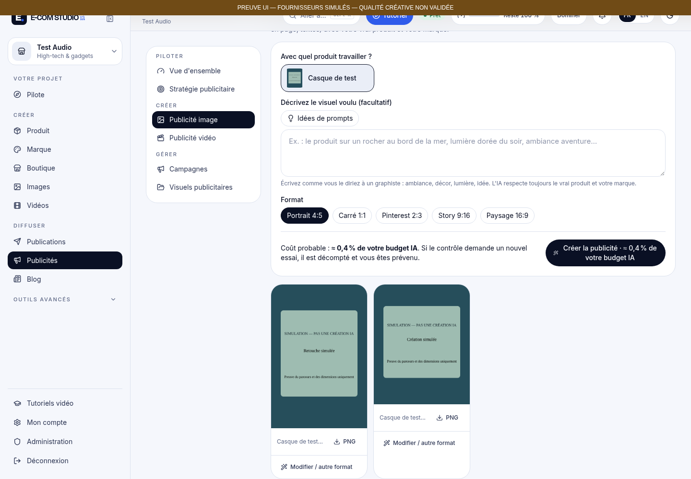
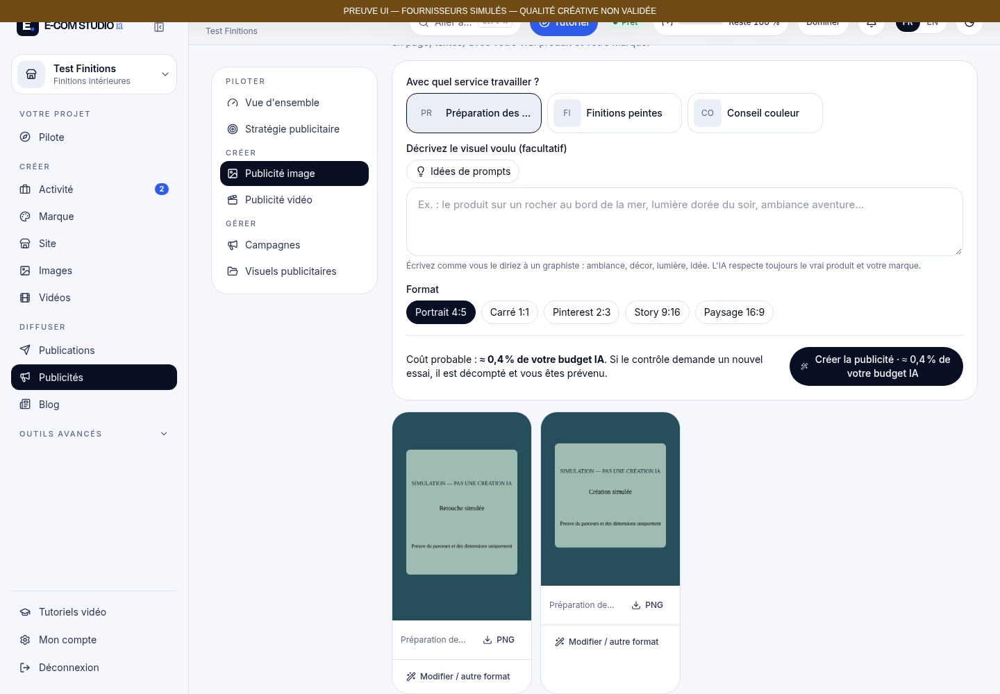

# Preuves des publications IA — fournisseurs simulés

> Preuves de la première passe. Pour la distinction Publicité / Publications et les parcours éditoriaux, voir [la nouvelle réception](../pr140-publications-editoriales/README.md).

**Ces fichiers prouvent le fonctionnement de l'interface, du moteur local, de la sauvegarde et du téléchargement. Ils ne prouvent pas la qualité créative d'une IA réelle. Aucun appel fournisseur, coût fournisseur, thème ni envoi social.** Les projets et leurs identités sont intégralement synthétiques ; les huit références privées, désormais toutes reçues et ouvertes, ne figurent pas dans ces fichiers. Voir l'[analyse des trois images complémentaires](REFERENCES_COMPLEMENT.md), ajoutée après les preuves techniques sans changer le code testé.

[Rapport de correction](../../docs/coordination/PUBLICATIONS_IA_QUALITE_RESULTATS.md) · [Validation](validation.json) · [Contrats, prompts effectifs et verdicts simulés](moteur-simulation.json) · [Résultats navigateur](browser-proof.json) · [Benchmark à autoriser](BENCHMARK.md) · [Devis indicatif](benchmark-quote.json) · [Empreintes des médias](manifest.json)

## À ouvrir en premier

| Cas | Capture complète après reprise | Vue lisible d'écran | Vidéo réelle de l'interface, fournisseurs simulés |
| --- | --- | --- | --- |
| Produit, ordinateur | [PNG](produit-ordinateur-04-reprise.png) | [PNG](produit-ordinateur-04-reprise-vue.png) | [WebM](produit-ordinateur.webm) |
| Produit, mobile | [PNG](produit-mobile-04-reprise.png) | [Retouche / format](produit-mobile-03-retouche-format-vue.png) | [WebM](produit-mobile.webm) |
| Service, ordinateur | [PNG](service-ordinateur-04-reprise.png) | [PNG](service-ordinateur-04-reprise-vue.png) | [WebM](service-ordinateur.webm) |
| Service, mobile | [PNG](service-mobile-04-reprise.png) | [Retouche / format](service-mobile-03-retouche-format-vue.png) | [WebM](service-mobile.webm) |

Les vidéos sont des enregistrements Chromium VP8, pas une vidéo IA. Leurs durées et dimensions sont vérifiées par `ffprobe` dans [videos.json](videos.json). Sur GitHub, ouvrir le fichier puis **Raw / Download** pour obtenir le binaire. Les captures complètes conservent le défilement ; les fichiers `-vue.png` montrent le cadre visible à la résolution native.

## Téléchargements natifs vérifiés

| Cas | 1080×1350 (4:5) | 1080×1620 (2:3) | 1080×1080 (1:1) |
| --- | --- | --- | --- |
| Produit | [PNG simulé](produit-4x5-SIMULATION.png) | [PNG simulé](produit-2x3-SIMULATION.png) | [PNG simulé](produit-1x1-SIMULATION.png) |
| Service | [PNG simulé](service-4x5-SIMULATION.png) | [PNG simulé](service-2x3-SIMULATION.png) | [PNG simulé](service-1x1-SIMULATION.png) |

Ces fichiers ont été téléchargés par l'API de fichiers authentifiée du studio puis décodés avec Sharp : format PNG, dimensions et taille binaire vérifiés. L'original est conservé après les deux nouvelles versions. Les neuf ratios offerts par la retouche sont aussi couverts par tests automatisés ; seuls les trois ratios ci-dessus sont téléchargés dans ce parcours navigateur.

Les journaux `tests.log`, `tests-cibles.log` et `build.log` conservent les sorties des commandes ; seuls les retours chariot et espaces de progression du terminal ont été normalisés. `typecheck.log` est vide, conformément à la sortie réussie de TypeScript.

## Étapes disponibles

Pour chaque cas, `02-creation-enregistree`, `03-retouche-format`, `04-reprise` et `05-bibliotheque`, chacun en capture complète et `-vue.png`. Les deux profils ordinateur incluent aussi `01-demande`. Total : **18 captures complètes, 18 vues d'écran, 4 vidéos, 6 PNG natifs**.

Le harnais utilise le vrai serveur Next, les vraies API, la file de jobs, SQLite et le moteur de publication ; seul le worker de preuve injecte un concepteur, un générateur et un contrôleur déterministes. Il n'y a pas de mode simulation dans le produit livré. Les scripts refusent un dossier ne portant pas leur préfixe de test avant de charger les accès applicatifs. Les bases, fichiers privés de session, secret d'application et faux credentials de readiness restent hors du dépôt.

Pour reproduire : base isolée `DATA_DIR=/chemin/absolu/ecs-publication-test-<nouvel-identifiant>`, `npx tsx scripts/publications/proof-harness.ts seed`, lancer Next sur `127.0.0.1:18130` avec le `.app-secret` du dossier de test sans l'afficher, puis le harnais `worker`, enfin `npx tsx scripts/publications/browser-proof.ts "$DATA_DIR"` dans un autre terminal. Le script navigateur utilise Chromium `/usr/bin/chromium` et nécessite le binaire ffmpeg de Playwright pour enregistrer les vidéos. Aucun lancement des workers de production ni accès aux données client n'est nécessaire. Terminer par `proof-harness.ts evidence` pour extraire uniquement les preuves expurgées.

L'essai créatif réel et le rapprochement coût/facture restent **non exécutés** ; voir [BENCHMARK.md](BENCHMARK.md).
